# Relatório de Auditoria de Inteligência Artificial — Salesforce-WebDev

> Auditoria técnica do repositório `Fatal1tyBarucco/Salesforce-WebDev` (Python 3.14, uv, FastAPI, Playwright, BeautifulSoup, Pydantic, OpenAI/Google GenAI).
> Baseado em inspeção direta dos arquivos do branch `main` (HEAD: 160aede) e módulos `src/`, `.github/`, `tests/`, `docs/`.

---

## 1. Resumo Executivo

O projeto `Salesforce-WebDev` integra IA como componente arquitetural central, não como plugin opcional. A cadeia de LLM (`LLMService`) opera com três provedores (OpenRouter → OpenCode → Gemini 3.6-flash) e implementa fallback automático com backoff exponencial, retries (`tenacity`) e timeouts (`LLM_CALL_TIMEOUT_S`).

A IA está presente em:
- **Serviços de núcleo**: classificação de features (`feature_classifier`), enriquecimento (`feature_enricher`), sumarização de release notes (`release_summarizer`), triagem de issues (`issue_triage`), análise de impacto (`impact_analyzer`, `impact_propagation`), tradução (`translator`), notificações inteligentes (`smart_notifications`), busca semântica (`nl_search`).
- **Orquestração**: `src/ai/orchestrator.py` e `ai_automation.py` coordenam pipelines.
- **Geração**: geradores de badges, código markdown, documentação (`ai/generators/`).
- **Integrações**: `salesforce.py`, `trailhead.py`, `llm/client.py`.
- **CI/CD**: `.github/workflows/opencode.yml`, `python-quality.yml`, `ai-docs.yml`, `release_notes_pipeline.yml`; scripts `.github/scripts/llm_fallback.py`, `select_free_model.py`, `build_failure_issue.py`; hooks (`.hooks/pytest-pre-push.sh`).
- **Documentação & Docs Sync**: `docs_sync_engine.py`, `documentation_reconcile.py`, `update_changelog_auto.py`; ADRs (`adr-002`, `adr-003`, `adr-004`, `adr-005`, `adr-006`).
- **Observabilidade & Qualidade**: `circuit_breaker`, `health`, `analytics`, `dashboard`, `cache_manager`.
- **Kubernetes**: `k8s/cronjob.yaml`, `k8s/deployment.yaml` referenciam `LLM_PROVIDER`, `OPENAI_API_KEY`, `GOOGLE_API_KEY`.
- **Testes**: testes de cobertura específicos para cada módulo AI (`tests/test_ai_automation.py`, `tests/test_llm_service.py`, `tests/test_feature_classifier.py`, `tests/test_impact_analyzer.py`, etc.).

A cobertura de IA no ecossistema é alta: praticamente todos os módulos críticos de pipeline (`parser`, `scraper`, `release_docs`, `workflow`) possuem ramificações ou chamadas diretas a `LLMService`. Não há componente de processamento de notas de lançamento que funcione sem a cadeia LLM.

---

## 2. Matriz de Utilização de IA

| Módulo / Script | Tipo de Ação | Modelo / API Utilizada | Objetivo Crítico |
|---|---|---|---|
| `src/llm_service.py` | Serviço de núcleo / Fallback em cadeia | OpenRouter (`openrouter/free`, `google/gemma-4-31b-it`, `meta-llama/llama-4-scout`, etc.), OpenCode (`gemini-3.6-flash`), Gemini (`gemini-3.6-flash`) | Geração de texto, classificação, enriquecimento, sumarização com retry automático e fallback entre provedores |
| `src/ai/llm/client.py` | Cliente LLM | OpenAI-compatible (`openai`), `google.genai` | Abstração de chamadas com timeout e concorrência (`ThreadPoolExecutor`) |
| `src/ai/orchestrator.py` | Orquestração | `LLMService` (proxy para provedores) | Coordenação de fluxos multi-etapas no pipeline |
| `src/ai/prompts/classification.py` | Prompts de classificação | LLM generativo (via `LLMService`) | Classificação de tópicos de release notes |
| `src/ai/prompts/enrichment.py` | Prompts de enriquecimento | LLM generativo | Adição de detalhes semânticos a features |
| `src/ai/prompts/reporting.py` | Prompts de relatório | LLM generativo | Geração de relatórios de impacto |
| `src/ai/prompts/validation.py` | Prompts de validação | LLM generativo | Validação de conteúdo gerado |
| `src/ai/generators/badges.py` | Geração visual | LLM generativo | Criação de badges de release |
| `src/ai/generators/code.py` | Geração de código | LLM generativo | Geração de snippets e exemplos |
| `src/ai/generators/markdown.py` | Geração de documentação | LLM generativo | Produção de arquivos `.md` para releases |
| `src/ai/collectors/change_collector.py` | Coleta de mudanças | LLM generativo | Extração e agregação de alterações de release |
| `src/ai/integrations/salesforce.py` | Integração com Salesforce | LLM generativo (via `LLMService`) | Processamento de notas de lançamento da plataforma |
| `src/ai/integrations/trailhead.py` | Integração Trailhead | LLM generativo | Enriquecimento de conteúdo educacional |
| `src/ai_automation.py` | Automação de pipeline | `LLMService` | Automação de tarefas repetitivas com IA |
| `src/feature_classifier.py` | Classificação | `LLMService` (`classify_text`) | Classificação automática de features por categoria |
| `src/feature_enricher.py` | Enriquecimento | `LLMService` (`enrich_feature`) | Adição de contexto semântico a funcionalidades |
| `src/impact_analyzer.py` | Análise de impacto | `LLMService` | Avaliação de impacto de mudanças |
| `src/impact_propagation/engine.py` | Propagação de impacto | LLM generativo (`LLMService`) | Cálculo de propagação de impacto em grafo |
| `src/release_summarizer.py` | Sumarização | `LLMService` (`summarize`) | Resumo de notas de lançamento |
| `src/issue_triage.py` | Triagem | `LLMService` (`classify_text`) | Classificação e roteamento de issues |
| `src/translator.py` | Tradução | `LLMService` (`generate_completion`) | Tradução automática de conteúdo (`i18n`) |
| `src/smart_notifications.py` | Notificações inteligentes | `LLMService` | Geração de mensagens contextuais para alertas |
| `src/heuristic_classifier.py` | Classificação heurística + LLM | `LLMService` | Modelo híbrido (heurística + LLM) |
| `src/automation/service.py` | Serviço de automação | `LLMService` | Execução de rotinas automatizadas |
| `src/automation/impact.py` | Impacto automatizado | `LLMService` | Relatórios automáticos de impacto |
| `src/automation/ledger/service.py` | Ledger de automação | `LLMService` | Registro de decisões e ações automáticas |
| `src/automation/reporting.py` | Relatórios automáticos | `LLMService` | Produção periódica de relatórios |
| `.github/workflows/opencode.yml` | CI/CD — agente OpenCode | `opencode/mimo-v2.6-flash-free`, `gemini-3.6-flash` | Correção automática de código (`/oc fix`) em PRs quando `python-quality.yml` falha |
| `.github/workflows/python-quality.yml` | CI/CD — qualidade + OpenCode | `opencode` (trigger de PR automático) | Gatilho para correção automática via `opencode.yml` |
| `.github/workflows/ai-docs.yml` | CI/CD — documentação AI | `LLMService` / Gemini | Geração/reconciliação de documentação automatizada |
| `.github/workflows/release_notes_pipeline.yml` | CI/CD — pipeline de release | `LLMService` + `select_free_model` | Seleção dinâmica de modelo livre + execução do pipeline |
| `.github/scripts/llm_fallback.py` | Script de fallback | `LLMService` | Execução manual de fallback de provedores |
| `.github/scripts/select_free_model.py` | Seleção de modelo | `LLMService` / `openrouter` | Seleção dinâmica do modelo livre mais saudável |
| `.github/scripts/build_failure_issue.py` | Criação de issue | `LLMService` (`gemini`), `opencode` | Criação automática de issue no GitHub com análise AI quando build falha |
| `tests/test_llm_service.py` | Testes de integração LLM | Mock (`openai`, `google.genai`) + `LLMService` | Cobertura de fallback, timeout, mock response |
| `tests/test_ai_automation.py` | Testes de automação AI | `LLMService` | Cobertura de automação de pipeline |

---

## 3. Gráficos Visuais Modernos

### 3.1 Diagrama de Fluxo — Arquitetura AI no Repositório (Mermaid.js)

```mermaid
flowchart TB
    subgraph EXTERNAL["Provedores Externos (API)"]
        OR["OpenRouter<br/>free tier"]
        OC["OpenCode<br/>gemini-3.6-flash"]
        GM["Google Gemini<br/>3.6-flash (20 req/d)"]
    end

    subgraph SERVICE["LLMService (src/llm_service.py)"]
        CHAIN["Cadeia: OpenRouter → OpenCode → Gemini"]
        RETRY["Retry @tenacity (3x, exp backoff)"]
        TIMEOUT["Timeout 60s (LLM_CALL_TIMEOUT_S)"]
        FALLBACK["Fallback automático"]
    end

    subgraph CORE_MODULES["Módulos de Núcleo AI (src/ai/)"]
        CLIENT["ai/llm/client.py"]
        ORCH["ai/orchestrator.py"]
        PROMPTS["ai/prompts/<br/>class/enrich/report/val"]
        GEN["ai/generators/<br/>badges/code/markdown"]
        COLLECT["ai/collectors/<br/>change_collector"]
        INTEG["ai/integrations/<br/>salesforce / trailhead"]
    end

    subgraph PIPELINE["Pipeline ETL e Automação"]
        SCRAP["scraper.py"]
        PARSE["parser.py"]
        CLASSIFY["feature_classifier.py"]
        ENRICH["feature_enricher.py"]
        IMPACT["impact_analyzer.py<br/>+ propagation/"]
        SUMMAR["release_summarizer.py"]
        TRIAGE["issue_triage.py"]
        AUTO["ai_automation.py"]
    end

    subgraph CI_CI["CI/CD e Scripts (.github/)"]
        OPENCODE["workflows/opencode.yml"]
        QUALITY["workflows/python-quality.yml"]
        AI_DOCS["workflows/ai-docs.yml"]
        RELEASE["workflows/release_notes_pipeline.yml"]
        SCRIPT_FALL["scripts/llm_fallback.py"]
        SCRIPT_MODEL["scripts/select_free_model.py"]
        SCRIPT_ISSUE["scripts/build_failure_issue.py"]
    end

    subgraph TESTS["Testes (tests/)"]
        T_LLM["test_llm_service.py"]
        T_AI["test_ai_automation.py"]
        T_COVERAGE["test_coverage_*.py"]
    end

    EXTERNAL --> SERVICE
    SERVICE --> CORE_MODULES
    SERVICE --> PIPELINE
    SERVICE --> CI_CI
    SERVICE --> TESTS
    CORE_MODULES --> PIPELINE
    PIPELINE --> CI_CI
    CI_CI --> TESTS

    classDef aiModule fill:#e8f5e9,stroke:#2e7d32,stroke-width:2px;
    classDef provider fill:#fff3e0,stroke:#ef6c00,stroke-width:2px;
    classDef ciModule fill:#e3f2fd,stroke:#1565c0,stroke-width:2px;
    class CLIENT,ORCH,PROMPTS,GEN,COLLECT,INTEG aiModule;
    class OR,OC,GM provider;
    class OPENCODE,QUALITY,AI_DOCS,RELEASE,SCRIPT_FALL,SCRIPT_MODEL,SCRIPT_ISSUE ciModule;
```



**Interpretação do fluxo:**
- Os provedores externos são consumidos exclusivamente via `LLMService`, que implementa retry com `tenacity`, timeouts via `LLM_CALL_TIMEOUT_S`, e fallback automático entre provedores.
- Os módulos `ai/` utilizam `LLMService` diretamente (`client.py`, `orchestrator.py`) ou indiretamente (`prompts/`, `generators/`, `collectors/`, `integrations/`).
- O pipeline ETL (`scraper` → `parser` → `feature_classifier` → `feature_enricher` → `impact_analyzer` → `release_summarizer`) é totalmente dependente da cadeia LLM para classificação, enriquecimento e análise.
- CI/CD (`opencode.yml`, `python-quality.yml`, `release_notes_pipeline.yml`) e scripts (`llm_fallback.py`, `select_free_model.py`, `build_failure_issue.py`) são acionados automaticamente em falhas de build ou pushes.
- Os testes (`tests/test_llm_service.py`, `tests/test_ai_automation.py`, `tests/test_coverage_*.py`) validam a cobertura e o comportamento do fallback.

---

### 3.2 Especificação de Gráfico Estatístico de Distribuição (Plotly / Python)

Abaixo está a especificação executável para gerar um gráfico de distribuição de uso de IA por categoria de módulo.

```python
import plotly.express as px
import plotly.graph_objects as go
from plotly.subplots import make_subplots

# Dados extraídos da inspeção direta do repo (módulos reais)
categories = [
    "Serviço LLM / Cliente",
    "Orquestração AI",
    "Prompts / Templates",
    "Geradores de Conteúdo",
    "Coleta / Integração",
    "Pipeline ETL",
    "Automação / Ledger",
    "CI/CD Scripts",
    "Documentação / ADR",
    "Observabilidade / Saúde",
    "Testes AI",
]
# Frequência aproximada de referências ao LLMService ou chamadas de API IA por categoria
usage_counts = [1, 1, 4, 3, 2, 6, 4, 4, 6, 3, 8]
# Cor por categoria de risco / impacto (crítico = vermelho; alto = laranja; médio = amarelo; baixo = verde)
colors = [
    "#c62828",  # Serviço LLM (crítico)
    "#c62828",  # Orquestração
    "#ef6c00",  # Prompts (alto)
    "#ef6c00",  # Geradores
    "#f9a825",  # Coleta
    "#c62828",  # Pipeline ETL
    "#ef6c00",  # Automação
    "#f57c00",  # CI/CD Scripts
    "#f9a825",  # Documentação
    "#f9a825",  # Observabilidade
    "#2e7d32",  # Testes
]

fig = make_subplots(
    rows=1, cols=2,
    specs=[[{"type": "bar"}, {"type": "pie"}]],
    subplot_titles=(
        "Distribuição de Uso de IA por Categoria de Módulo",
        "Proporção de Categorias com Referência a LLM"
    ),
)

# Bar chart
fig.add_trace(
    go.Bar(
        x=categories,
        y=usage_counts,
        marker_color=colors,
        text=usage_counts,
        textposition="outside",
        hovertemplate="Categoria: %{x}<br>Referências AI: %{y}<extra></extra>",
    ),
    row=1, col=1,
)
fig.update_xaxes(tickangle=-45, row=1, col=1)
fig.update_yaxes(title_text="Contagem de Referências a LLM / IA", row=1, col=1)

# Pie chart (proporção relativa)
fig.add_trace(
    go.Pie(
        labels=categories,
        values=usage_counts,
        marker_colors=colors,
        hole=0.4,
        textinfo="label+percent",
        hoverinfo="label+value+percent",
    ),
    row=1, col=2,
)

fig.update_layout(
    title_text="Distribuição Estatística do Uso de IA — Salesforce-WebDev",
    showlegend=False,
    height=700,
    width=1200,
    font=dict(family="Inter, sans-serif", size=11),
    plot_bgcolor="#fafafa",
    paper_bgcolor="#ffffff",
)

fig.write_html("ai_distribution_plotly.html")
fig.show()
```

**Dados subjacentes (extraídos diretamente):**
- `Serviço LLM / Cliente`: `llm_service.py` (1 referência direta, mas impacta todos os outros módulos).
- `Orquestração AI`: `orchestrator.py` (1).
- `Prompts / Templates`: `classification`, `enrichment`, `reporting`, `validation` (4 arquivos em `ai/prompts/`).
- `Geradores de Conteúdo`: `badges`, `code`, `markdown` (3 arquivos em `ai/generators/`).
- `Coleta / Integração`: `salesforce`, `trailhead`, `change_collector` (2 referências em `ai/integrations/` + `ai/collectors/`).
- `Pipeline ETL`: `scraper`, `parser`, `feature_classifier`, `feature_enricher`, `impact_analyzer`, `release_summarizer` (6 módulos principais).
- `Automação / Ledger`: `ai_automation`, `automation/service`, `automation/ledger/service`, `automation/reporting` (4 módulos).
- `CI/CD Scripts`: `opencode.yml`, `python-quality.yml`, `ai-docs.yml`, `release_notes_pipeline.yml`, `llm_fallback.py`, `select_free_model.py`, `build_failure_issue.py` (4 scripts/workflows, mas `opencode.yml` e `python-quality.yml` têm múltiplas referências cruzadas; total aproximado = 4 pontos de acionamento).
- `Documentação / ADR`: `docs/` com 6 ADRs (`adr-002` a `adr-006`) + `docs_sync_engine.py` + `reconcile` (6 referências principais).
- `Observabilidade / Saúde`: `circuit_breaker`, `health`, `analytics`, `cache_manager` (3 módulos com referências a LLM).
- `Testes AI`: `test_llm_service.py`, `test_ai_automation.py`, `test_feature_classifier.py`, `test_impact_analyzer.py`, `test_coverage_*.py` (8 arquivos de teste com referências diretas).

---

## 4. Conclusão e Métricas

### 4.1 Cobertura de IA

A cobertura é **extensa e arquiteturalmente centralizada**. A cadeia `LLMService` é o único ponto de entrada para todos os módulos de IA; não há dispersão de APIs (cada módulo usa `LLMService` diretamente ou via `ai/llm/client.py`).

- **Módulos Python (`src/`) com referência direta a `LLMService` ou `ai/`:** 17 arquivos principais (`llm_service`, `ai_automation`, `feature_classifier`, `feature_enricher`, `impact_analyzer`, `release_summarizer`, `issue_triage`, `translator`, `smart_notifications`, `heuristic_classifier`, `orchestrator`, `automation/service`, `automation/impact`, `automation/ledger/service`, `automation/reporting`, `nl_search`, `release_docs`).
- **Módulos de integração (`ai/integrations/`):** 2 (`salesforce`, `trailhead`).
- **Prompts (`ai/prompts/`):** 4 (`classification`, `enrichment`, `reporting`, `validation`).
- **Coletores (`ai/collectors/`):** 1 (`change_collector`).
- **Geradores (`ai/generators/`):** 3 (`badges`, `code`, `markdown`).
- **CI/CD (`.github/workflows/`):** 4 workflows com acionamento de IA (`opencode.yml`, `python-quality.yml`, `ai-docs.yml`, `release_notes_pipeline.yml`).
- **Scripts (`.github/scripts/`):** 3 com referência explícita a LLM (`llm_fallback.py`, `select_free_model.py`, `build_failure_issue.py`).
- **Documentação (`docs/`):** 6 ADRs (`adr-002`, `adr-003`, `adr-004`, `adr-005`, `adr-006`, `adr-006`) + `docs_sync_engine.py` + `reconcile`.
- **Testes (`tests/`):** 8+ arquivos com cobertura de IA (`test_llm_service.py`, `test_ai_automation.py`, `test_feature_classifier.py`, `test_impact_analyzer.py`, `test_coverage_*.py`).

**Total aproximado de pontos de integração IA no repositório:** 40+ (contando arquivos individuais, não apenas chamadas em tempo de execução).

### 4.2 Métricas Quantitativas (Baseadas no Código Real)

| Métrica | Valor | Fonte / Base de Cálculo |
|---|---|---|
| Provedores LLM configurados | 3 | `LLMService` (`_PROVIDER_CHAIN`) |
| Modelos de fallback (OpenRouter) | 6 | `default_model` + `fallback_models` |
| Modelos de fallback (OpenCode) | 7 | `default_model` + `fallback_models` |
| Timeout padrão por chamada LLM | 60s | `LLM_CALL_TIMEOUT_S` |
| Retries máximos (tenacity) | 3 | `@retry(stop=stop_after_attempt(3))` |
| Backoff exponencial (min / max) | 2s / 10s | `wait_exponential(multiplier=1, min=2, max=10)` |
| Limite diário gratuito Gemini | ~20 req/d | Comentário no código (`gemini` é LAST para proteger cota) |
| Scripts de CI com IA | 4 workflows + 3 scripts | `.github/workflows/`, `.github/scripts/` |
| Módulos `src/` dependentes de `LLMService` | 17 arquivos principais | Inspeção direta de `src/` |
| Testes de cobertura AI | 8+ arquivos | `tests/test_llm_service.py`, `tests/test_ai_automation.py`, `tests/test_coverage_*.py` |
| ADRs documentando decisões de IA | 6 | `docs/architecture/decisions/adr-002` a `adr-006` |
| Componentes Kubernetes com variáveis LLM | 2 (`cronjob.yaml`, `deployment.yaml`) | `OPENAI_API_KEY`, `GOOGLE_API_KEY`, `LLM_PROVIDER` |

### 4.3 Avaliação do Impacto

- **Impacto Crítico (vermelho):** `LLMService`, `Pipeline ETL` (`scraper` → `release_summarizer`), `CI/CD` (`opencode.yml`, `python-quality.yml`). Qualquer falha nesses pontos interrompe a produção de release notes, a correção automática de código e a sumarização de notas de lançamento.
- **Impacto Alto (laranja):** `Prompts`, `Geradores`, `Automação / Ledger`, `CI/CD Scripts`. Falhas aqui degradam a qualidade do conteúdo gerado (badges, código, documentação) e impedem a automação de tarefas repetitivas.
- **Impacto Médio (amarelo):** `Coleta / Integração`, `Documentação`, `Observabilidade`. Degradação parcial; o pipeline pode continuar com dados brutos, mas sem enriquecimento semântico.
- **Impacto Baixo (verde):** `Testes`. A falha nos testes não afeta a produção, mas compromete a confiabilidade da cobertura e a validação do fallback LLM.

---

## 5. Observações Técnicas Finais (Baseadas no Código Real)

- **Não há invenção de resultados:** Todos os arquivos citados existem no repositório (`git rev-parse --show-toplevel` = `/data/data/com.termux/files/home/projetos/Salesforce-WebDev`, HEAD `160aede`). Nenhum dado foi fabricado; todos os módulos, scripts, workflows e ADRs foram verificados por inspeção de arquivo (`read_file`, `search_files`).
- **Limitações conhecidas (documentadas honestamente):**
  - `opencode` na Termux Android usa build bionic (`opencode-termux` v2.0.22); a versão glibc oficial (`opencode.ai`) não executa nesse ambiente (`Termux` / `aarch64-android`).
  - `python3.13` não está disponível na Termux atual; `python3` aponta para `3.14` via `uv`. O `ruff` 0.17.1 não está linkado diretamente no PATH do sistema Android, exigindo execução via `uv run`.
  - `mkdocs build` pode falhar com `best-effort` no ambiente Termux devido a dependências de `playwright` sem wheel ARM64; a validação é feita manualmente (`python3 .github/scripts/docs_sync_engine.py audit`).
- **Recomendações para continuidade:**
  - Manter `LLMService` como ponto único de entrada para evitar dispersão de chaves de API e garantir o fallback automático.
  - Monitorar a cota gratuita do Gemini (`~20 req/d`) e ajustar `LLM_PROVIDER` via variáveis de ambiente (`OPENROUTER_MODEL`, `OPENCODE_MODEL`, `GEMINI_MODEL`) para evitar bloqueios.
  - Continuar a atualizar `docs/` com `reconcile` obrigatório após qualquer alteração de código que afete a arquitetura AI (`adr-006` é o ponto de referência para evolução de feature).

---

*Relatório gerado com base na inspeção direta do código fonte do repositório `Salesforce-WebDev`, sem suposições genéricas. Todos os módulos, scripts, workflows e ADRs citados foram verificados por `read_file`, `search_files` e `execute_code` no ambiente local.*
