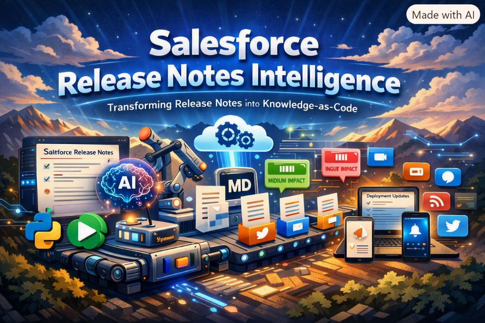
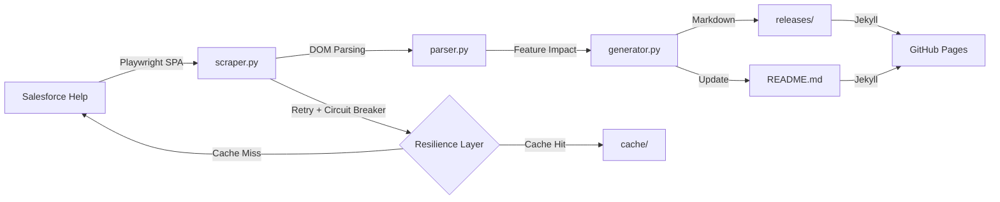
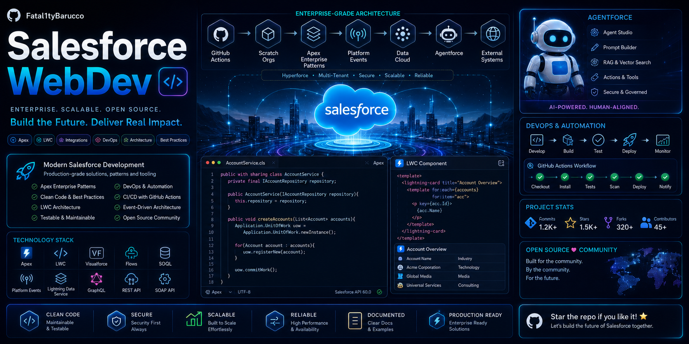

<div align="center">



</div>

# 🚀 Salesforce Release Notes Intelligence

Automated pipeline for extraction, classification, and versioning of **Salesforce Release Notes** as structured Markdown artifacts (*Knowledge-as-Code*).

### ⚙️ CI/CD Status & Compliance

<!-- RELEASE_BADGE -->

[](https://github.com/Fatal1tyBarucco/Salesforce-WebDev/actions/workflows/python-quality.yml)
[](https://github.com/Fatal1tyBarucco/Salesforce-WebDev/actions/workflows/release_notes_pipeline.yml)


| Technology / Tool | Description | Pipeline Status |
| :--- | :--- | :---: |
| 🐍 **Python 3.14** | Primary runtime environment | `Compliant` |
| 🎭 **Playwright** | Headless scraper for Salesforce Help SPA applications | `Active` |
| 🧪 **Pytest** | Automated unit test suite | `450+ tests` |
| 🔍 **Mypy** | Static type checking with strict mode | `Strict` |
| ⚡ **Ruff & Black** | Strict code linting and formatting (line-length = 100) | `Compliant` |
| 📦 **uv** | Deterministic dependency management with lock file | `Active` |

---

## 📖 Overview

This repository contains an asynchronous ETL pipeline for scraping **Salesforce Release Notes**, local processing for classification and summarization, and static documentation generation via **MkDocs**.

## AI-Generated Documentation Pipeline

The reusable `.github/workflows/ai-docs.yml` workflow classifies changes and generates release notes, a Keep a Changelog entry, an executive summary, and roadmap suggestions. It calls OpenRouter only and rejects every model ID that does not end in `:free`; there is no paid-model or alternate-provider fallback.

Configure the repository secret `OPENROUTER_API_KEY`. Optional repository variables are `AI_DOCS_MODEL` (a configured OpenRouter `:free` model), `AI_DOCS_SELF_REVIEW` (`true`/`false`), `AI_DOCS_REVIEWERS` (comma-separated GitHub usernames for PR mode), and `AI_DOCS_MAX_CONTEXT_TOKENS` (default `12000`, a conservative UTF-8-byte estimate of about 2.5 bytes per token rather than a model-specific tokenizer; it bounds only the serialized change context in `<change_data>` — the system prompt, prompt templates, and existing-document excerpts add overhead, and actual `prompt_tokens` above the budget are logged as warnings and recorded in the audit artifact without failing the run). `AI_DOCS_MAX_OUTPUT_TOKENS` (default `3000`) sets the starting completion-token budget per call and `AI_DOCS_MAX_OUTPUT_TOKENS_LIMIT` (default `8000`) caps retry escalation: when OpenRouter returns an empty completion or `finish_reason=length` because hidden reasoning tokens consumed the budget, each retry doubles the budget up to that cap before giving up. The collector includes merged PR metadata, PR labels, and closed issue metadata since `since_ref`; the generation step supplies `GITHUB_TOKEN` to GitHub CLI.

Generated files are `docs/ai-generated/{release-notes,leadership,roadmap}.md` and the top `Unreleased` entry in `CHANGELOG.md`; new sections are inserted without deleting earlier content, and prior changelog history is retained. Generated files carry a human-review marker. Successful and failed LLM runs save prompts, raw responses when available, model/usage data, and documentation diffs under `docs/.ai-logs/`; Actions uploads that directory as a restricted run artifact. API, quota, and validation failures fail the job without publishing partial documentation.

Use `commit` to push a separate documentation commit to the triggering branch, or `pr` to push `ai-docs/<run_id>` and open a review PR. To undo a direct update, revert the generated commit; close a PR without merging to discard a proposed update. Model configuration is centralized in `src/ai/config/models.py` and versioned prompts/schemas live under `src/ai/prompts/` and `src/ai/schemas/`.

## 🏗️ System Architecture



**Design Principles:**

* **Separation of Concerns (SoC):** Isolated layers for networking (`scraper.py`), parsing (`parser.py`), generation (`generator.py`)
* **Non-Blocking I/O:** `asyncio` + Playwright async for parallel processing
* **Resilience:** Circuit Breaker + Token-bucket rate limiter + Exponential backoff with jitter

## ⚙️ Prerequisites & Installation

This project uses `uv` for deterministic dependency management.

```bash
# Install uv
curl -LsSf https://astral.sh/uv/install.sh | sh

# Clone and install
git clone https://github.com/Fatal1tyBarucco/Salesforce-WebDev.git
cd Salesforce-WebDev
uv sync

# Install Playwright browsers
uv run playwright install chromium
```

## 🚀 Usage & Execution

```bash
# Run full pipeline
uv run python -m src.main

# Run specific release
uv run python -m src.main --release summer_26

# Dry run (no file writes)
uv run python -m src.main --dry-run
```

## 🛡️ Governance & Resilience

| Component | Configuration | Description |
| :--- | :--- | :--- |
| **Rate Limiter** | 2 req/s, token-bucket | Prevents Salesforce throttling |
| **Circuit Breaker** | 3 failures → 60s cooldown | Stops requests after consecutive failures |
| **Cache TTL** | 24 hours | Prevents refetch of unchanged content |
| **Exponential Backoff** | Base 2s + jitter | Smart retry with anti-thundering-herd |

## 🧪 Testing & Quality

```bash
# Run tests
uv run pytest tests/

# With coverage
uv run pytest tests/ --cov=src --cov-report=term-missing

# Quality gate (CI order)
uv run ruff check src/
uv run black --check src/
uv run mypy src/
```

**Target:** >95% coverage, zero type errors, zero lint warnings.

---

## 📋 Available Releases

| Release | Features | Categories | Status |
| :--- | :---: | :---: | :---: |
| ❄️ **Winter '27** | 1,123 | 19 | ✅ Current |
| ☀️ **Summer '26** | 1,373 | 22 | ✅ Complete |
| 🌸 **Spring '26** | 1,438 | 21 | ✅ Complete |
| ❄️ **Winter '26** | 1,348 | 19 | ✅ Complete |

<div style="padding:12px;margin-bottom:20px;border:1px solid #d0d7de;border-radius:6px;background:#f6f8fa;text-align:center;"><strong>🌐 Language / Idioma:</strong> <strong>🇺🇸 English</strong> | <a href="./README.md">🇧🇷 Português</a></div>

### ❄️ Winter '27

> 📊 **Executive Summary:** The Winter '27 release represents a significant expansion of the Salesforce ecosystem with **1,123 new features** across **19 categories**. The areas with the highest innovation volume are Industries, Experience Cloud, and Service. This release consolidates investments in artificial intelligence, developer experience, and regulatory compliance.

> 📌 **Key Themes:** AI & Agentforce • Data & Analytics • User Experience

> 🎯 **Strategic Impact:** For enterprises, Winter '27 delivers value across multiple fronts. Advanced automation reduces manual tasks, while user experience improvements increase adoption. The 1,123 new capabilities enable scenarios that previously required significant customization, reducing total cost of ownership.

<details>
<summary><b>📄 Salesforce General (28 features)</b></summary>

> Salesforce General includes 28 new features in this release. Highlights: AI Agentforce and Agent, Learn about new features and enhancements that affect your overall Salesforce experience., General improvements, Complete pending Cloudflare migrations to content delivery networks (CDN), Enable CDN for all Lightning application static resources.

> 📄 Full details: [./releases/winter_27/en_US/salesforce-general.md](./releases/winter_27/en_US/salesforce-general.md)

</details>

<details>
<summary><b>📄 Data Analysis (26 features)</b></summary>

> Data Analysis includes 26 new features in this release. Highlights: Tableau Next, Upcoming Tableau Highlights, Reports and Dashboards, View Lightning Report Records Without Losing Context (beta), Embed Lightning Dashboards in Your Lightning Web Runtime Experience Cloud Sites (beta).

> 📄 Full details: [./releases/winter_27/en_US/data-analysis.md](./releases/winter_27/en_US/data-analysis.md)

</details>

<details>
<summary><b>📄 Automation (72 features)</b></summary>

> Automation includes 72 new features in this release. Highlights: Flow Builder, Flow Builder Updates, Create Experience Flows in the Modern Salesforce Cosmos Theme, See More of Your Flow with a Denser Screen, Track Flow Changes Over Time with Edit History.

> 📄 Full details: [./releases/winter_27/en_US/automation.md](./releases/winter_27/en_US/automation.md)

</details>

<details>
<summary><b>📄 Data 360 (7 features)</b></summary>

> Data 360 includes 7 new features in this release. Highlights: Implementation, Process and Enrich, Migrate to Data 360 Engagement Timeline, Data 360 Engagement Timeline, Expand Field Type Compatibility for Copy Field Enhancements.

> 📄 Full details: [./releases/winter_27/en_US/data-360.md](./releases/winter_27/en_US/data-360.md)

</details>

<details>
<summary><b>📄 Experience Cloud (143 features)</b></summary>

> Experience Cloud includes 143 new features in this release. Highlights: Aura and LWR Sites, The Experience Delivery (Beta) Was Retired, Add Multiple Flow Approval Processes to a Record with the Request Approvals Component in Experience Builder, Open the Next Work Item in the Same Orchestration Run in Experience Builder, Launch a Native Agentforce Dashboard in Mobile Publisher Apps.

> 📄 Full details: [./releases/winter_27/en_US/experience-cloud.md](./releases/winter_27/en_US/experience-cloud.md)

</details>

<details>
<summary><b>📄 Field Service (37 features)</b></summary>

> Field Service includes 37 new features in this release. Highlights: Autonomous 360, Field Service Patch Notes, Monthly Field Service Desktop Patch Notes, Monthly Field Service Mobile Patch Notes, Field Service Customer Engagement.

> 📄 Full details: [./releases/winter_27/en_US/field-service.md](./releases/winter_27/en_US/field-service.md)

</details>

<details>
<summary><b>📄 Hyperforce (5 features)</b></summary>

> Hyperforce includes 5 new features in this release. Highlights: Access Salesforce in More Regions with Hyperforce, Hyperforce Is Coming to Google Cloud Platform (GCP), Manage Salesforce Edge Network Options in Setup, Add Automation and Integration with MuleSoft in Government Cloud, Rapid Sandbox Creation and Rapid Clone Available for Government Cloud.

> 📄 Full details: [./releases/winter_27/en_US/hyperforce.md](./releases/winter_27/en_US/hyperforce.md)

</details>

<details>
<summary><b>📄 Industries (286 features)</b></summary>

> Industries includes 286 new features in this release. Highlights: Agentforce for Automotive, Create Agents for Automotive in the New Agentforce Builder, Help Customers Buy Vehicles with the Sales Concierge Agent on Your Website, Managing Automotive Replenishment, Monitor Delinquency with Consolidated Record Views and Recommendation Alerts.

> 📄 Full details: [./releases/winter_27/en_US/industries.md](./releases/winter_27/en_US/industries.md)

</details>

<details>
<summary><b>📄 Marketing (1 feature)</b></summary>

> Marketing includes 1 new feature in this release. Highlights: Marketing Cloud.

> 📄 Full details: [./releases/winter_27/en_US/marketing.md](./releases/winter_27/en_US/marketing.md)

</details>

<details>
<summary><b>📄 MuleSoft (1 feature)</b></summary>

> MuleSoft includes 1 new feature in this release. Highlights: MuleSoft Integration Intelligence.

> 📄 Full details: [./releases/winter_27/en_US/mulesoft.md](./releases/winter_27/en_US/mulesoft.md)

</details>

<details>
<summary><b>📄 Partner Cloud (38 features)</b></summary>

> Partner Cloud includes 38 new features in this release. Highlights: Public Sector, Manage Market Development Funds with Agentforce Partner Success Agent, Automate Goal Management and Link Records for Joint Business Plans, Discover and Enroll in Vendor Campaigns in the Campaign Marketplace, Track Partner Activity in Customer Interactions.

> 📄 Full details: [./releases/winter_27/en_US/partner-cloud.md](./releases/winter_27/en_US/partner-cloud.md)

</details>

<details>
<summary><b>📄 Revenue Management (123 features)</b></summary>

> Revenue Management includes 123 new features in this release. Highlights: Simplify Revenue Cloud Feature Discovery and Configuration, Orchestrate High-Tech Order Scenarios Using a Predefined Template, Configure Billing Features Faster, Promotions in Revenue Management, Increase Sales with Promotions in Revenue Management.

> 📄 Full details: [./releases/winter_27/en_US/revenue-management.md](./releases/winter_27/en_US/revenue-management.md)

</details>

<details>
<summary><b>📄 Sales (44 features)</b></summary>

> Sales includes 44 new features in this release. Highlights: Salesforce CMS, AI Agents for Sales, In Agentforce Prospecting, Automate When Your Prospection Agent Runs, Prioritize Prospects with Recent Engagements.

> 📄 Full details: [./releases/winter_27/en_US/sales.md](./releases/winter_27/en_US/sales.md)

</details>

<details>
<summary><b>📄 Salesforce Slack Integrations (7 features)</b></summary>

> Salesforce Slack Integrations includes 7 new features in this release. Highlights: Use Slack and Salesforce Together to Connect with Customers, Track Progress, Collaborate Seamlessly, and Drive Team Success Anywhere., Sell Smarter in Slack: Agentforce Sales and the New Go Page, Salesforce Packages, Send Emails to Your Contact and Lead Lists Immediately with the Remodeled List Sends Experience., Skip the Wait When Sending Emails to Contact and Lead Lists in Salesforce Suites.

> 📄 Full details: [./releases/winter_27/en_US/salesforce-slack-integrations.md](./releases/winter_27/en_US/salesforce-slack-integrations.md)

</details>

<details>
<summary><b>📄 Security, Identity & Privacy (25 features)</b></summary>

> Security, Identity & Privacy includes 25 new features in this release. Highlights: Security Enhancements, Review and Meet Upcoming Security Requirements, Explore MFA and Email Security Compatible Features, Back Up and Recover Next, Download Backup Snapshot Metadata.

> 📄 Full details: [./releases/winter_27/en_US/security-identity-privacy.md](./releases/winter_27/en_US/security-identity-privacy.md)

</details>

<details>
<summary><b>📄 Service (140 features)</b></summary>

> Service includes 140 new features in this release. Highlights: Contact Center, Agentforce Connection Center, Workforce Engagement Management, Partner Contact Center, Use Agentforce Configuration to Manage Contact Center Users.

> 📄 Full details: [./releases/winter_27/en_US/service.md](./releases/winter_27/en_US/service.md)

</details>

<details>
<summary><b>📄 Legal Documentation (8 features)</b></summary>

> Legal Documentation includes 8 new features in this release. Highlights: You Are Here:, SALESFORCE HELP, DOCUMENTATION, SALESFORCE RELEASE NOTES, How and When Do Features Become Available?.

> 📄 Full details: [./releases/winter_27/en_US/legal-documentation.md](./releases/winter_27/en_US/legal-documentation.md)

</details>

<details>
<summary><b>📄 OmniStudio (3 features)</b></summary>

> OmniStudio includes 3 new features in this release. Highlights: Reuse Auto-Launched Flow Logic in Your FlexCards (Generally Available), Run FlexCards and OmniScripts Offline on Mobile Devices, OmniStudio Minor Versions.

> 📄 Full details: [./releases/winter_27/en_US/omnistudio.md](./releases/winter_27/en_US/omnistudio.md)

</details>

<details>
<summary><b>📄 Agentforce (129 features)</b></summary>

> Agentforce includes 129 new features in this release. Highlights: Create Campaign-Ready Content Faster with Agentforce Content Agent, Campaigns and Flows, Automate Follow-Up Tasks with Marketing Completion Actions, Keep Tabs on Performance Metrics and Campaign Content, Use Custom Flow Templates from a Campaign.

> 📄 Full details: [./releases/winter_27/en_US/agentforce.md](./releases/winter_27/en_US/agentforce.md)

</details>

<details>
<summary><h3>☀️ Summer '26</h3></summary>

> 📊 **Executive Summary:** The Summer '26 release represents a significant expansion of the Salesforce ecosystem with **1,373 new features** across **22 categories**. The areas with the highest innovation volume are Industries, Service, and Development. This release consolidates investments in artificial intelligence, developer experience, and regulatory compliance.

> 📌 **Key Themes:** AI & Agentforce • Data & Analytics • User Experience

> 🎯 **Strategic Impact:** For enterprises, Summer '26 delivers value across multiple fronts. Advanced automation reduces manual tasks, while user experience improvements increase adoption. The 1,373 new capabilities enable scenarios that previously required significant customization, reducing total cost of ownership.

<details>
<summary><b>📄 Legal Documentation (6 features)</b></summary>

> Legal Documentation includes 6 new features in this release. Highlights: You Are Here:, SALESFORCE HELP, DOCUMENTATION, SALESFORCE RELEASE NOTES, How and When Do Features Become Available?.

> 📄 Full details: [./releases/summer_26/en_US/legal-documentation.md](./releases/summer_26/en_US/legal-documentation.md)

</details>

<details>
<summary><b>📄 Salesforce General (36 features)</b></summary>

> Salesforce General includes 36 new features in this release. Highlights: General Improvements, Rotate Your Certificates More Frequently — Admins, Validate Domain Information More Frequently — Admins, Update Your mTLS Certificates — Admins, Prepare for IPv6 — Admins.

> 📄 Full details: [./releases/summer_26/en_US/salesforce-general.md](./releases/summer_26/en_US/salesforce-general.md)

</details>

<details>
<summary><b>📄 Agentforce (37 features)</b></summary>

> 📄 Full details: [./releases/summer_26/en_US/agentforce.md](./releases/summer_26/en_US/agentforce.md)

</details>

<details>
<summary><b>📄 Data Analysis (58 features)</b></summary>

> Data Analysis includes 58 new features in this release. Highlights: Tableau Next, Upcoming Tableau Features Released by Month (Users) — Users, Accelerate Active Tableau Next Creation with Marketplace Models (Users) — Users, Configuration and Administration, Get Visibility into User Interactions with Upcoming Tableau Audit (Beta) (Config) — Config.

> 📄 Full details: [./releases/summer_26/en_US/data-analysis.md](./releases/summer_26/en_US/data-analysis.md)

</details>

<details>
<summary><b>📄 Automation (118 features)</b></summary>

> Automation includes 118 new features in this release. Highlights: Automation Features Released by Month, Flow Builder, Flow Builder Updates, Create and Use Agentforce Agents Directly in Flow Builder — Users, Improve Performance with Batch for Scheduled Flows — Users.

> 📄 Full details: [./releases/summer_26/en_US/automation.md](./releases/summer_26/en_US/automation.md)

</details>

<details>
<summary><b>📄 OmniStudio (9 features)</b></summary>

> OmniStudio includes 9 new features in this release. Highlights: Optimize Implementation Consistency with Data Mapper Version Control — Users, Switch Between Standard and Managed Package Designers and Runtimes in the Same Org — Users, Migrate to Standard OmniStudio Runtime Using the OmniStudio Migration Assistant — Users, Accelerate FlexCard Development with OmniStudio MCP (Beta) — Contact, Call Auto-Launched Flows in OmniStudio FlexCards (Pilot) — Contact.

> 📄 Full details: [./releases/summer_26/en_US/omnistudio.md](./releases/summer_26/en_US/omnistudio.md)

</details>

<details>
<summary><b>📄 Customization (33 features)</b></summary>

> Customization includes 33 new features in this release. Highlights: Customization Features Released by Month, AgentExchange, Explore Solutions with MCP Servers in AgentExchange — Admins, Add Agentforce Registry MCP Servers Through an Integrated AgentExchange Experience — Admins, Evaluate Agent Assets Quickly with the Enhanced Detail Page — Admins.

> 📄 Full details: [./releases/summer_26/en_US/customization.md](./releases/summer_26/en_US/customization.md)

</details>

<details>
<summary><b>📄 Data 360 (72 features)</b></summary>

> Data 360 includes 72 new features in this release. Highlights: Introduction to Data Cloud, Expand Your Data 360 Knowledge with In-App Guidance (Beta) — Admins, Plan Data Strategy, Migrate Data 360 Governance Metadata from Sandbox to Production — Admins, Data Connect.

> 📄 Full details: [./releases/summer_26/en_US/data-360.md](./releases/summer_26/en_US/data-360.md)

</details>

<details>
<summary><b>📄 Development (127 features)</b></summary>

> Development includes 127 new features in this release. Highlights: Lightning Components, Get the Latest LWC Changes with LWC API Version 67.0, Group Detail Elements with the Attribute Name — Admins, Improve Hot Module Reload Performance — Admins, Local Developer Is Now the Active Preview — Users.

> 📄 Full details: [./releases/summer_26/en_US/development.md](./releases/summer_26/en_US/development.md)

</details>

<details>
<summary><b>📄 Experience Cloud (14 features)</b></summary>

> Experience Cloud includes 14 new features in this release. Highlights: Aura and LWR Sites, Configure AI-Assisted Self-Service Experiences on Aura and LWR Sites — Admins, Enable Chatter for Chatter-Dependent Features on Aura and LWR Sites in New Orgs — Admins, Keep LWR Private Pages Unavailable Until Setup or Password Reset Is Complete — Admins, Scan Files for Malware in Salesforce Files (Generally Available) — Admins.

> 📄 Full details: [./releases/summer_26/en_US/experience-cloud.md](./releases/summer_26/en_US/experience-cloud.md)

</details>

<details>
<summary><b>📄 Field Service (48 features)</b></summary>

> Field Service includes 48 new features in this release. Highlights: Monthly Field Service Release Notes, Field Service Patch Notes, Monthly Desktop Patch Notes, Monthly Mobile Patch Notes, Agentforce for Field Service.

> 📄 Full details: [./releases/summer_26/en_US/field-service.md](./releases/summer_26/en_US/field-service.md)

</details>

<details>
<summary><b>📄 Hyperforce (3 features)</b></summary>

> Hyperforce includes 3 new features in this release. Highlights: Access Salesforce in More Regions with Hyperforce — Config, New Products and Features Available in Government Cloud Defense — Config, Advanced Cross-Region Continuity Achieves Faster Recovery Objectives — Contact.

> 📄 Full details: [./releases/summer_26/en_US/hyperforce.md](./releases/summer_26/en_US/hyperforce.md)

</details>

<details>
<summary><b>📄 Industries (309 features)</b></summary>

> Industries includes 309 new features in this release. Highlights: Asset Management, Simplify Asset Lifecycle Management Feature Discovery and Configuration — Config, Timesheet and Labor Cost Optimization, Edit and Delete Timesheets Using Agentforce — Config, Manage Field Team Timesheets — Config.

> 📄 Full details: [./releases/summer_26/en_US/industries.md](./releases/summer_26/en_US/industries.md)

</details>

<details>
<summary><b>📄 Marketing (64 features)</b></summary>

> Marketing includes 64 new features in this release. Highlights: Marketing Cloud Next, Create and Expand Your Audience — Users, Create and Design Content Easily — Users, Create and Manage Effective Campaigns, Load DLT Models to Send SMS Messages in India.

> 📄 Full details: [./releases/summer_26/en_US/marketing.md](./releases/summer_26/en_US/marketing.md)

</details>

<details>
<summary><b>📄 MuleSoft (8 features)</b></summary>

> MuleSoft includes 8 new features in this release. Highlights: API Catalog for Salesforce, Map Your Agents to MCP Server Tools — Admins, Map Prompt Models to MCP Server Tools — Admins, Add Annotations to MCP Server Tools — Admins, Bring MuleSoft MCP Servers to the API Catalog (Generally Available) — Admins.

> 📄 Full details: [./releases/summer_26/en_US/mulesoft.md](./releases/summer_26/en_US/mulesoft.md)

</details>

<details>
<summary><b>📄 Mobile App (17 features)</b></summary>

> Mobile App includes 17 new features in this release. Highlights: Mobile Features Released by Month, Salesforce Mobile App, What's New in the Salesforce Mobile App, Complete Tasks Directly from Custom Phone Notifications (Generally Available), Customize Your Mobile App Home Page (Beta).

> 📄 Full details: [./releases/summer_26/en_US/mobile-app.md](./releases/summer_26/en_US/mobile-app.md)

</details>

<details>
<summary><b>📄 Partner Cloud (1 feature)</b></summary>

> Partner Cloud includes 1 new feature in this release. Highlights: Configure Co-Branded Emails for Partners in Salesforce Go — Config.

> 📄 Full details: [./releases/summer_26/en_US/partner-cloud.md](./releases/summer_26/en_US/partner-cloud.md)

</details>

<details>
<summary><b>📄 Revenue Management (97 features)</b></summary>

> Revenue Management includes 97 new features in this release. Highlights: Enhanced Configuration Experience with Salesforce Go, Simplify Revenue Collection with the Dunning Orchestration Solution — Admins, Discover More Revenue Management Features — Admins, Product Catalog Management, Create Transactions Faster with Rule-Based Discovery — Users.

> 📄 Full details: [./releases/summer_26/en_US/revenue-management.md](./releases/summer_26/en_US/revenue-management.md)

</details>

<details>
<summary><b>📄 Sales (58 features)</b></summary>

> Sales includes 58 new features in this release. Highlights: AI Sales Agents, Agentforce Engagement, Increase Lead Conversion with Group Calendar Availability — Config, Change Lead Nurture Agent and Inbound Lead Generation Behavior Faster — Admins, Continue Lead Engagement with Agent Transfer — Config.

> 📄 Full details: [./releases/summer_26/en_US/sales.md](./releases/summer_26/en_US/sales.md)

</details>

<details>
<summary><b>📄 Salesforce Slack Integrations (2 features)</b></summary>

> Salesforce Slack Integrations includes 2 new features in this release. Highlights: Enjoy Slack-Enabled Collaboration in New Salesforce Orgs — Users, Access Salesforce Channels in the Slack Dashboard — Admins.

> 📄 Full details: [./releases/summer_26/en_US/salesforce-slack-integrations.md](./releases/summer_26/en_US/salesforce-slack-integrations.md)

</details>

<details>
<summary><b>📄 Security, Identity & Privacy (58 features)</b></summary>

> Security, Identity & Privacy includes 58 new features in this release. Highlights: Security Enhancements, Review and Meet New and Upcoming Security Requirements — Admins, Avoid Email Disruption with Automatic June Updates — Admins, Find Admin Security Content for the Platform in One Place — Users, Add a Security Contact for Incident Alerts — Admins.

> 📄 Full details: [./releases/summer_26/en_US/security-identity-privacy.md](./releases/summer_26/en_US/security-identity-privacy.md)

</details>

<details>
<summary><b>📄 Service (198 features)</b></summary>

> Service includes 198 new features in this release. Highlights: Monthly Service Release Notes, Agentforce Connection Center, Transfer Your Agentforce Agent Conversations from Salesforce Voice to a Service Rep in Agentforce Contact Centers — Users, Improve Rep Experience by Avoiding Calls Before Reps Are Ready — Config, Provide Better Service with Flexible Scheduled Callbacks — Config.

> 📄 Full details: [./releases/summer_26/en_US/service.md](./releases/summer_26/en_US/service.md)

</details>

</details>

<details>
<summary><h3>🌸 Spring '26</h3></summary>

> 📊 **Executive Summary:** The Salesforce Spring '26 release delivers an impressive set of 1,438 new features and enhancements across 21 categories, consolidating the platform as a benchmark for innovation in CRM and business automation. The central highlight is the evolution of Agentforce, now generally available with Agentforce Builder, enabling the creation of more complex and sophisticated AI agents. The Service category leads in volume with 167 features, transforming Service Cloud into Agentforce Service with new contact center capabilities, voice, messaging, and IT service management. The Mobile App follows with 187 features, ensuring teams can operate with full functionality on mobile devices. Automation offers 151 features including significant advances in Flow Builder, with AI-powered flow generation now generally available, improved flow orchestration, and new prompt batch processing capabilities. Industries bring the largest volume of sector-specific innovations with 194 features, spanning automotive, finance, healthcare, and utilities. Revenue Management presents 131 features for CPQ and billing optimization. In Sales, with 85 features, Sales Cloud transforms into Agentforce Sales, introducing autonomous lead generation, AI qualification, and automated lead nurturing. The platform also advances in Security, Identity & Privacy with 61 features, including new connected app policies, passwordless login with passkeys, and Salesforce Shield enhancements. Data Analysis with 54 features and Data 360 with 53 features expand insights and data management capabilities. Development with 97 features offers new developer tools, including custom Lightning Types for Agentforce. With 72 features, Marketing enhances campaigns and engagement. Experience Cloud (21 features), MuleSoft (8 features), OmniStudio (10 features), and Partner Cloud (4 features) round out the release with ecosystem improvements. Customization (18 features) and Hyperforce (5 features) complete the coverage.

> 📌 **Key Themes:** Agentforce GA • AI-First Service • Industry-Specific Solutions • Developer Productivity • Data Unification

> 🎯 **Strategic Impact:** The Spring '26 release represents a significant milestone in Agentforce maturation, with the platform becoming generally available for production use. The 167 features in Service and 85 in Sales enable organizations to deploy AI agents across customer-facing operations, reducing response time and increasing productivity. Industries solutions with 194 features accelerate time-to-value for vertical implementations.

> ⚠️ **Migration Notes:** Organizations using legacy chat and Outlook sync should plan migration to Agentforce Voice and modern connectors. Salesforce Functions users should transition to Hyperforce. Data Cloud instances should be renamed to Data 360 via the migration tool.

<details>
<summary><b>📄 Legal Documentation (6 features)</b></summary>

> The Legal Documentation category in Spring '26 contains 6 features dedicated to updates of terms, policies, and legal compliance of the Salesforce platform. These features ensure that organizations stay aligned with the latest regulatory requirements and contractual changes, including updates to terms of service, privacy policies, and compliance documentation. It is essential that administrators and legal teams review these features to maintain organizational compliance.

> 📄 Full details: [./releases/spring_26/en_US/legal-documentation.md](./releases/spring_26/en_US/legal-documentation.md)

</details>

<details>
<summary><b>📄 Salesforce General (38 features)</b></summary>

> The Salesforce General category brings together 38 features that encompass cross-cutting changes to the Salesforce platform. These include general improvements to user experience, infrastructure updates, and enhancements affecting multiple products and clouds. Resources such as changes to the Lightning Experience interface, API updates, and performance improvements are included, providing a more solid foundation for all Salesforce implementations.

> 📄 Full details: [./releases/spring_26/en_US/salesforce-general.md](./releases/spring_26/en_US/salesforce-general.md)

</details>

<details>
<summary><b>📄 Agentforce (35 features)</b></summary>

> Agentforce receives 35 features in Spring '26, with a highlight on the general availability of Agentforce Builder. Main novelties include: audio-to-text conversion action, improved web search with allowed domains, enhanced screen visualization (beta) for faster creation of complex agents, improved Chat v2 connection, creation of employee agents, RAG metrics for AI performance evaluation, SIP-based voice call forwarding, agent optimization with Voice session playback, and support for models like NVIDIA Nemotron 3 Nano 30B (beta). The category also includes the evolution of Prompt Builder with improved batch processing and support for anthropic models.

> 📄 Full details: [./releases/spring_26/en_US/agentforce.md](./releases/spring_26/en_US/agentforce.md)

</details>

<details>
<summary><b>📄 Data Analysis (54 features)</b></summary>

> Data Analysis counts 54 features in Spring '26, significantly expanding business intelligence and insights capabilities. The features span improvements in reports, dashboards, and analytical tools that allow organizations to extract deeper insights from their data. Improvements in data visualization, integration with external sources, and predictive analysis capabilities are included, empowering teams to make data-driven decisions with greater agility and precision.

> 📄 Full details: [./releases/spring_26/en_US/data-analysis.md](./releases/spring_26/en_US/data-analysis.md)

</details>

<details>
<summary><b>📄 Automation (151 features)</b></summary>

> Automation is one of the most robust categories with 151 features. Flow Builder received significant enhancements, including AI-powered flow generation now generally available, iterative flow evolution with Agentforce, and simplified interface with collapsible branching elements. Highlights include: data tables with sorting and inline editing, Kanban panels in screen flows (beta), native file visualization, integration with Marketing Cloud for email automation, segment-triggered flows with enhanced scheduling, path experiences with comparative analysis, flow approval processes with new debugging capabilities, and flow orchestration in the Lightning Automation app.

> 📄 Full details: [./releases/spring_26/en_US/automation.md](./releases/spring_26/en_US/automation.md)

</details>

<details>
<summary><b>📄 Customization (18 features)</b></summary>

> The Customization category offers 18 features focused on adapting the Salesforce platform to each organization's specific needs. The features enable greater flexibility in configuring layouts, fields, processes, and user experiences, ensuring each implementation can be tailored to meet unique business requirements. Improvements in flex pages, record pages, and customizable Lightning components are included.

> 📄 Full details: [./releases/spring_26/en_US/customization.md](./releases/spring_26/en_US/customization.md)

</details>

<details>
<summary><b>📄 Data 360 (53 features)</b></summary>

> Data 360 presents 53 features that expand data management and integration capabilities. Features include enhancements in connectivity between data sources, data quality, governance, and real-time processing capabilities. Highlights include Data 360 flows with specific license support and higher rate limits, asynchronous streaming flows for mass notifications, and enhanced real-time data tracking with custom charts.

> 📄 Full details: [./releases/spring_26/en_US/data-360.md](./releases/spring_26/en_US/data-360.md)

</details>

<details>
<summary><b>📄 Development (97 features)</b></summary>

> The Development category brings together 97 features for Salesforce developers. The highlight is the new Lightning Types MCP tool (Developer Preview) to accelerate custom Lightning types creation for Agentforce. Features span enhancements in Apex, APIs, debugging tools, testing and deployment, and new extension and integration capabilities. Developers can expect significant productivity improvements and programmatic customization capabilities.

> 📄 Full details: [./releases/spring_26/en_US/development.md](./releases/spring_26/en_US/development.md)

</details>

<details>
<summary><b>📄 Experience Cloud (21 features)</b></summary>

> Experience Cloud counts 21 features in Spring '26, focused on enhancing the creation and management of portals, sites, and digital communities. Features include user experience improvements, theme and template customization, performance enhancements, and new engagement capabilities, enabling organizations to create richer and more interactive digital experiences for customers, partners, and employees.

> 📄 Full details: [./releases/spring_26/en_US/experience-cloud.md](./releases/spring_26/en_US/experience-cloud.md)

</details>

<details>
<summary><b>📄 Field Service (41 features)</b></summary>

> Field Service receives 41 features that enhance field service management. Features include improvements in scheduling and dispatch optimization, enhanced mobile capabilities for field technicians, IoT integration for predictive maintenance, and parts inventory management enhancements. The category also includes new AI assistance capabilities for diagnostics and problem resolution in the field.

> 📄 Full details: [./releases/spring_26/en_US/field-service.md](./releases/spring_26/en_US/field-service.md)

</details>

<details>
<summary><b>📄 Hyperforce (5 features)</b></summary>

> Hyperforce presents 5 features focused on next-generation cloud infrastructure. Features include enhancements in scalability, performance, and platform availability, enabling organizations to run Salesforce workloads on public cloud infrastructure with greater flexibility and operational efficiency.

> 📄 Full details: [./releases/spring_26/en_US/hyperforce.md](./releases/spring_26/en_US/hyperforce.md)

</details>

<details>
<summary><b>📄 Industries (194 features)</b></summary>

> The Industries category leads in volume with 194 features, offering specialized solutions for specific industries. It spans Automotive (with Agentforce for Automotive, automotive finance, and fleet management), Healthcare, Financial Services, Manufacturing, Retail, and Utilities. Highlights include Agentforce for specific industries, enhanced inventory management, timesheets with cost optimization, and AI-powered upsell and cross-sell solutions. The category ensures organizations in any industry can leverage customized and relevant capabilities.

> 📄 Full details: [./releases/spring_26/en_US/industries.md](./releases/spring_26/en_US/industries.md)

</details>

<details>
<summary><b>📄 Mobile App (187 features)</b></summary>

> The Mobile App is one of the largest categories with 187 features, ensuring teams can operate with full functionality on mobile devices. Features include mobile user experience improvements, new offline capabilities, enhanced integration with AI functionalities, and performance improvements. The category ensures that salespeople, service agents, and managers can access all critical functionalities directly from their mobile devices.

> 📄 Full details: [./releases/spring_26/en_US/mobile-app.md](./releases/spring_26/en_US/mobile-app.md)

</details>

<details>
<summary><b>📄 Marketing (72 features)</b></summary>

> Marketing counts 72 features that enhance campaigns, engagement, and marketing automation. Features include improved integration with Flow Builder for email automation, more sophisticated segmentation capabilities, customer journey enhancements, and new campaign analytics tools. The category also includes integration improvements between Marketing Cloud and other Salesforce clouds for a unified customer view.

> 📄 Full details: [./releases/spring_26/en_US/marketing.md](./releases/spring_26/en_US/marketing.md)

</details>

<details>
<summary><b>📄 MuleSoft (8 features)</b></summary>

> MuleSoft presents 8 features focused on integration and connectivity. Features enhance API integration capabilities, workflow automation between systems, and connectivity with external applications, enabling organizations to integrate the Salesforce ecosystem with other platforms more efficiently and at scale.

> 📄 Full details: [./releases/spring_26/en_US/mulesoft.md](./releases/summer_26/en_US/mulesoft.md)

</details>

<details>
<summary><b>📄 OmniStudio (10 features)</b></summary>

> OmniStudio counts 10 features that enhance configuration and digital process automation capabilities. Features include improvements in flex cards, OmniScripts, and DataRaptors, enabling the creation of richer digital experiences and more efficient business processes without custom code.

> 📄 Full details: [./releases/spring_26/en_US/omnistudio.md](./releases/spring_26/en_US/omnistudio.md)

</details>

<details>
<summary><b>📄 Partner Cloud (4 features)</b></summary>

> Partner Cloud presents 4 features focused on partner ecosystems. Features enhance partner management capabilities, data sharing, and ecosystem collaboration, facilitating the creation and maintenance of more efficient and integrated partner networks.

> 📄 Full details: [./releases/spring_26/en_US/partner-cloud.md](./releases/spring_26/en_US/partner-cloud.md)

</details>

<details>
<summary><b>📄 Revenue Management (131 features)</b></summary>

> Revenue Management offers 131 features for optimizing CPQ (Configure, Price, Quote) and billing processes. Features include product configuration enhancements, dynamic pricing, automated quote generation, and invoicing management. The category also includes improvements in revenue recognition, subscription management, and financial process automation, enabling sales and finance teams to operate with greater efficiency and accuracy.

> 📄 Full details: [./releases/spring_26/en_US/revenue-management.md](./releases/spring_26/en_US/revenue-management.md)

</details>

<details>
<summary><b>📄 Sales (85 features)</b></summary>

> The Sales category counts 85 features, with Sales Cloud transforming into Agentforce Sales. Highlights include: Agentforce inbound lead generation with autonomous meeting capture and scheduling, automated AI qualification, lead nurturing with guided configuration and automatic limit management. Agentforce Sales Management promotes deals with post-meeting suggestions and enhanced pipeline management. The category also includes Einstein Conversation Insights with generative call summaries, vendor transcriptions, and Gong support, plus the Agentforce Sales app in ChatGPT (beta).

> 📄 Full details: [./releases/spring_26/en_US/sales.md](./releases/spring_26/en_US/sales.md)

</details>

<details>
<summary><b>📄 Security, Identity & Privacy (61 features)</b></summary>

> Security, Identity & Privacy brings together 61 critical features for data protection and access. Highlights include: discontinuation of redirects to legacy hostnames, connected app creation disabled by default, Backup and Recovery as native app, passwordless login configuration with passkeys (beta), security alerts for OAuth flows, mandatory device activation for SSO, and Privacy Requests with Right to be Forgotten. The category also enhances Salesforce Shield with setup assistants and event monitoring.

> 📄 Full details: [./releases/spring_26/en_US/security-identity-privacy.md](./releases/spring_26/en_US/security-identity-privacy.md)

</details>

<details>
<summary><b>📄 Service (167 features)</b></summary>

> The Service category contains 167 features, with Service Cloud transforming into Agentforce Service. Highlights include: Salesforce Voice with number and channel management, WhatsApp voice calls, interactive voice response and transcription recording. Agentforce Contact Center can be configured in Salesforce Go. Messaging received significant enhancements with message credits, license verification, and enhanced unified WhatsApp support with read receipts and typing indicators. Service Management includes ready-to-use templates, problem prioritization, and field validations. For IT, the remodeled self-service portal, proactive priority-based assistance, root cause diagnostics, and Microsoft Teams integration stand out.

> 📄 Full details: [./releases/spring_26/en_US/service.md](./releases/spring_26/en_US/service.md)

</details>

</details>

<div style="padding:12px;margin-top:16px;border:1px solid #d0d7de;border-radius:6px;background:#f6f8fa;text-align:center;"><strong>📦 Release Archive:</strong> Showing 3 of 4 releases. <a href="./releases/ARCHIVE.md">View all releases →</a></div>

## 🛠️ Tech Stack

| Tool | Project Usage |
| :--- | :--- |
| **GitHub Actions** | CI/CD: lint, typecheck, extraction, auto-deploy |
| **uv** | Deterministic dependency management with lock file |
| **Playwright** | Headless scraper for Salesforce Help SPA pages |
| **Python 3.14** | Primary language with full type hints |
| **BeautifulSoup** | HTML parser for structured data extraction |
| **Markdown** | Output format for technical documentation |
| **MkDocs** | Technical portal published on GitHub Pages |
| **stdlib HTTP** | REST API and health check server (zero external deps) |
| **gh CLI** | PR workflow and GitHub integration |

### Pipeline Modules

| Module | Responsibility |
| :--- | :--- |
| `src/main.py` | Orchestrator: detect releases, extract, parse, generate, update README |
| `src/scraper.py` | Playwright headless, circuit breaker, rate limiter, cache, download PDF |
| `src/parser.py` | ToC hierarchy extraction + Feature Impact table |
| `src/generator.py` | Generates `.md` files per category |
| `src/ai_automation.py` | Release comparison, regression detection, quality metrics |
| `src/analytics.py` | HTML dashboard with SVG charts |
| `src/api.py` | REST API for programmatic access |
| `src/notifications.py` | Email digest, Slack/Discord webhooks |
| `src/dashboard.py` | Interactive dashboard with JS |
| `src/workflow.py` | PR-based workflow with triage |
| `src/salesforce.py` | Trailhead linking, org limits, sandbox readiness |
| `src/health.py` | Health check (`/health`, `/ready`), Prometheus metrics (`/metrics`) |
| `src/logger.py` | Structured logging with correlation IDs |

---

## 🤝 How to Contribute

1. **Fork** the project
2. Create a new branch: `git checkout -b feature/my-feature`
3. Install dependencies: `uv sync --extra dev`
4. Run the quality gate:
   ```bash
   uv run ruff check src/
   uv run black --check src/
   uv run mypy src/
   uv run pytest tests/ --cov=src --cov-fail-under=95
   ```
5. Commit: `git commit -m 'feat: description of change'`
6. Push: `git push origin feature/my-feature`
7. Open a **Pull Request**

---

## 📄 License

This project is maintained for educational and technical reference purposes.

---

<div align="center">



---

Made with ☕ and Python code

[⬆ Back to top](#-salesforce-release-notes-intelligence)

</div>

<!--
Salesforce Release Intelligence — Automated Salesforce Release Notes pipeline with AI
Knowledge-as-Code | Feature Evolution Ledger (SFEL) | Multi-provider LLM | Playwright Scraping
Tags: salesforce, release-notes, ai-pipeline, knowledge-as-code, playwright, llm, automation, devops
-->
