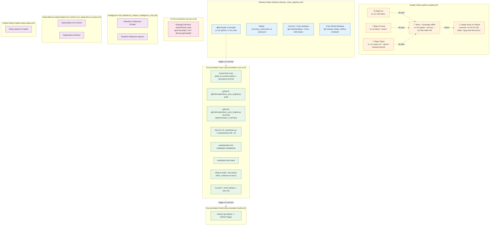

# Arquitetura do Salesforce-WebDev — Fase 0: Diagnóstico

> **Versão**: 1.0 (2026-11-15)
> **Base**: inspeção direta do branch `feat/fase-0-diagnostico` (HEAD: 93cf8c2) e módulos `src/`, `.github/`, `tests/`.
> **Objetivo**: Visão completa da arquitetura atual com diagramas Mermaid válidos, sem placeholders.

---

## 1. Diagrama de Componentes / Módulos

```mermaid
flowchart TB
    subgraph EXTERNAL["Serviços Externos (fronteiras não confiáveis)"]
        SF_HELP["Salesforce Help Portal (SPA)\nHTML/JS renderizado via Playwright"]
        OR["OpenRouter API\n(free tier, modelo openrouter/free + fallbacks)"]
        OC["OpenCode API\n(gemini-3.6-flash + free variants)"]
        GM["Google Gemini API\n(3.6-flash, ~20 req/dia free tier)"]
        GH["GitHub API\n(Issues, Releases, Contents)"]
    end

    subgraph INFRA["Infraestrutura (src/infrastructure/)"]
        SCRAPER_ADAPTER["ScrapingAdapter / PlaywrightScrapingAdapter\nsrc/infrastructure/scraping.py:27-97"]
        PARSER_ADAPTER["ParsingAdapter / BeautifulSoupParsingAdapter\nsrc/infrastructure/parsing.py:31-74"]
        LLM_ADAPTER_INFRA["UnifiedLLMClient + Adapters\nsrc/infrastructure/llm.py:153-974"]
        STORAGE["StorageAdapter (FileSystem / GitHub)\nsrc/infrastructure/storage.py"]
        TRANSLATOR_INFRA["TranslationAdapter\nsrc/infrastructure/translation.py"]
        GENERATOR_INFRA["GenerationAdapter\nsrc/infrastructure/generation.py"]
        NOTIFIER_INFRA["NotificationAdapter\nsrc/infrastructure/notification_step.py"]
        GITHUB_INFRA["GitHubAdapter\nsrc/infrastructure/github.py"]
        MESSAGING["EventBus (infra)\nsrc/infrastructure/messaging.py"]
    end

    subgraph CORE["Core Services (src/core/) — Clean Architecture"]
        PIPELINE_CORE["PipelineOrchestrator\nsrc/orchestrator.py:40-196"]
        CLASSIFICATION_SVC["ClassificationService\nsrc/core/classification/service.py:69-244"]
        ENRICHMENT_SVC["EnrichmentService\nsrc/core/enrichment/service.py:82-278"]
        SUMMARIZATION_SVC["SummarizationService\nsrc/core/summarization/service.py"]
        PIPELINE_STEPS["PipelineStep contracts\nsrc/core/pipeline/steps.py:22-169"]
        IMPACT_ENGINE["ImpactPropagationEngine\nsrc/impact_propagation/engine.py"]
    end

    subgraph AI["AI Layer (src/ai/) — LLM Orchestration"]
        AI_ORCHESTRATOR["AIOrchestrator\nsrc/ai/orchestrator.py"]
        AI_LLM_CLIENT["OpenRouter-only LLMClient\nsrc/ai/llm/client.py:259-491"]
        AI_PROMPTS["Prompts: classification, enrichment, reporting, validation\nsrc/ai/prompts/"]
        AI_SCHEMAS["Pydantic Schemas: Change, EnrichmentOutput, etc.\nsrc/ai/schemas/"]
        AI_INTEGRATIONS["Integrations: Salesforce, Trailhead\nsrc/ai/integrations/"]
        AI_COLLECTORS["ChangeCollector\nsrc/ai/collectors/change_collector.py"]
        AI_CONFIG["Model Config\nsrc/ai/config/models.py"]
    end

    subgraph LEGACY["Módulos Legados em src/ (raiz) — coexistem com Clean Arch"]
        MAIN["main.py (entrypoint + DI PipelineConfig)\nsrc/main.py:1-628"]
        ORCHESTRATOR_LEGACY["PipelineOrchestrator (legacy)\nsrc/orchestrator.py"]
        SCRAPER_LEGACY["SalesforceReleaseScraper (Playwright + cache + circuit breaker)\nsrc/scraper.py:76-668"]
        PARSER_LEGACY["ReleaseNotesParser + FeatureImpactParser\nsrc/parser.py:33-635"]
        LLM_SERVICE["LLMService (multi-provider fallback chain)\nsrc/llm_service.py:105-490"]
        FEATURE_ENRICHER["FeatureEnricher (batch enrichment)\nsrc/feature_enricher.py:64-379"]
        RELEASE_SUMMARIZER["ReleaseSummarizer (executive summaries)\nsrc/release_summarizer.py:51-525"]
        RELEASE_DOCS["release_docs.py (Markdown + README generation)\nsrc/release_docs.py:1-848"]
        FEATURE_CLASSIFIER["FeatureClassifier\nsrc/feature_classifier.py"]
        HEURISTIC_CLASSIFIER["HeuristicClassifier\nsrc/heuristic_classifier.py"]
        TRANSLATOR["TranslatorService\nsrc/translator.py"]
        GENERATOR["MarkdownGenerator\nsrc/generator.py"]
        CONFIG["config.py (constants, ReleaseInfo, TopicNode)\nsrc/config.py:1-242"]
        RELEASE_DISCOVERY["ReleaseDiscoveryService\nsrc/release_discovery.py:71-344"]
        DOC_SERVICE["DocumentationService\nsrc/documentation_service.py"]
        EVENTS["EventBus + get_event_bus (singleton)\nsrc/events.py:61-184"]
        CACHE["CacheManager\nsrc/cache_manager.py"]
        CIRCUIT_BREAKER["CircuitBreaker\nsrc/circuit_breaker.py"]
        RATE_LIMITER["RateLimiter\nsrc/limiters/rate_limiter.py"]
        MODELS_ROOT["Pydantic Models (src/models/)\nsrc/models/*.py"]
        AUTOMATION["AIAutomationService, IssueTriager, ImpactAnalyzer, SmartNotificationEngine\nsrc/ai_automation.py, src/issue_triage.py, src/impact_analyzer.py, src/smart_notifications.py"]
    end

    EXTERNAL --> INFRA
    EXTERNAL --> LEGACY
    INFRA --> CORE
    CORE --> AI
    AI --> INFRA
    LEGACY -.-> INFRA
    LEGACY -.-> CORE
    LEGACY -.-> AI

    classDef external fill:#fff3e0,stroke:#ef6c00,stroke-width:2px;
    classDef infra fill:#e3f2fd,stroke:#1565c0,stroke-width:2px;
    classDef core fill:#e8f5e9,stroke:#2e7d32,stroke-width:2px;
    classDef ai fill:#fce4ec,stroke:#c2185b,stroke-width:2px;
    classDef legacy fill:#f3e5f5,stroke:#7b1fa2,stroke-width:2px,stroke-dasharray: 5 5;

    class SF_HELP,OR,OC,GM,GH external;
    class SCRAPER_ADAPTER,PARSER_ADAPTER,LLM_ADAPTER_INFRA,STORAGE,TRANSLATOR_INFRA,GENERATOR_INFRA,NOTIFIER_INFRA,GITHUB_INFRA,MESSAGING infra;
    class PIPELINE_CORE,CLASSIFICATION_SVC,ENRICHMENT_SVC,SUMMARIZATION_SVC,PIPELINE_STEPS,IMPACT_ENGINE core;
    class AI_ORCHESTRATOR,AI_LLM_CLIENT,AI_PROMPTS,AI_SCHEMAS,AI_INTEGRATIONS,AI_COLLECTORS,AI_CONFIG ai;
    class MAIN,ORCHESTRATOR_LEGACY,SCRAPER_LEGACY,PARSER_LEGACY,LLM_SERVICE,FEATURE_ENRICHER,RELEASE_SUMMARIZER,RELEASE_DOCS,FEATURE_CLASSIFIER,HEURISTIC_CLASSIFIER,TRANSLATOR,GENERATOR,CONFIG,RELEASE_DISCOVERY,DOC_SERVICE,EVENTS,CACHE,CIRCUIT_BREAKER,RATE_LIMITER,MODELS_ROOT,AUTOMATION legacy;
```



**Fronteiras não confiáveis (untrusted boundaries)**:

- **HTML externo**: `SalesforceReleaseScraper._exec_fetch()` (src/scraper.py:205-233) recebe HTML renderizado do Salesforce Help Portal — estrutura pode mudar sem aviso.
- **Respostas de LLM**: `LLMService._dispatch_to_provider()` (src/llm_service.py:275-298) e `UnifiedLLMClient._dispatch_to_provider()` (src/infrastructure/llm.py:321-344) processam JSON não validado de provedores externos — pode conter campos inesperados, truncamento (`finish_reason=length`), recusas (`content_filter`), ou JSON inválido.
- **GitHub API**: `AIAutomationService.create_github_issue()` e `GitHubAdapter` dependem de `GITHUB_TOKEN` / `RELEASE_TOKEN` — rate limits, permissões (ex.: criação de refs bloqueada em alguns orgs, issue #112), e schema de resposta podem variar.

---

## 2. Diagrama de Fluxo de Dados (ETL Pipeline)

```mermaid
flowchart LR
    subgraph DETECT["1. Detecção de Release"]
        DISCOVERY["ReleaseDiscoveryService.discover()\nsrc/release_discovery.py:131-167"]
        STRATEGY1["Content Comparison\nfetch_page_raw_text(current) vs fetch_page_raw_text(candidate)\nsrc/release_discovery.py:193-277"]
        STRATEGY2["ID Increment Heuristic (fallback)\nrelease_id + 2 sem verificação de rede\nsrc/release_discovery.py:279-303"]
    end

    subgraph SCRAPE["2. Scraping (Playwright + Chromium)"]
        FETCH_HTML["fetch_page()\nwait_until=domcontentloaded + 5s wait + scroll + TOC expansion\nsrc/scraper.py:112-233"]
        FETCH_TEXT["fetch_page_raw_text()\nTTL cache 24h (CacheManager, config)\nsrc/scraper.py"]
        FETCH_LINKS["fetch_features_with_links()\nHTML parsing com BeautifulSoup\nsrc/scraper.py:385-442"]
        FETCH_PDF["download_pdf_from_button()\nclique em button[title='Open PDF']\nsrc/scraper.py:582-645"]
    end

    subgraph PARSE["3. Parsing (BeautifulSoup + lxml)"]
        TOC_PARSE["ReleaseNotesParser.extract_topic_tree()\nli[role='treeitem'] -> TopicNode tree\nsrc/parser.py:40-90"]
        IMPACT_PARSE["FeatureImpactParser.parse_text()\nTexto bruto -> FeatureImpactCategory[]\nsrc/parser.py:456-536"]
        LINK_MAP["link_map: feature_name -> docs_url\nextraído de fetch_features_with_links\nsrc/main.py:474-477"]
    end

    subgraph ENRICH["4. Enriquecimento IA"]
        CLASSIFY["FeatureClassifier.classify_release()\nsrc/feature_classifier.py -> LLMService.classify_text()"]
        HEURISTIC["HeuristicClassifier (fallback)\nkeyword-based, sem LLM\nsrc/heuristic_classifier.py"]
        ENRICH_BATCH["FeatureEnricher.enrich_category()\n1 call LLM por categoria (batch)\nsrc/feature_enricher.py:74-137"]
        ENRICH_RELEASE["FeatureEnricher.enrich_release()\ncarrega .md do pt_BR, enriquece tudo\nsrc/feature_enricher.py:139-214"]
        TRANSLATE["TranslatorService.translate_feature()\npt-BR <-> en-US via LLM\nsrc/translator.py"]
    end

    subgraph GENERATE["5. Geração de Artefatos Versionados"]
        MD_GEN["MarkdownGenerator.generate()\n-> releases/{slug}/{locale}/*.md\nsrc/generator.py + src/release_docs.py:_generate_release_files()"]
        README_UPD["DocumentationService.update_readme_all()\nbilingual README.md + README.en.md\nsrc/release_docs.py:790-847"]
        SUMMARY_CACHE["generate_summary_cache()\nReleaseSummarizer -> .summary_cache.json\nsrc/main.py:231-336 + src/release_summarizer.py"]
        META_JSON["_meta.json (source of truth)\ntotal_features, categories, version, release_id\nsrc/release_docs.py:394-450"]
    end

    subgraph AI_REPORTS["6. Relatórios IA Assíncronos (concorrentes)"]
        CHANGELOG["AIAutomationService.generate_changelog()\n-> CHANGELOG.md"]
        QUALITY["-> QUALITY_REPORT.md"]
        REGRESSION["generate_regression_report()\n-> REGRESSION_REPORT.md"]
        DIFF["generate_diff_report()\n-> DIFF_REPORT.md"]
        IMPACT_RPT["ImpactAnalyzer.analyze()\n-> IMPACT_REPORT.md"]
        NOTIF["SmartNotificationEngine.generate_digest()\n-> NOTIFICATION_DIGEST.md"]
        TRIAGE["IssueTriager.triage_issue()\n-> GitHub Issues"]
    end

    DETECT --> SCRAPE
    SCRAPE --> PARSE
    PARSE --> ENRICH
    ENRICH --> GENERATE
    GENERATE --> AI_REPORTS
    PARSE --> META_JSON
    GENERATE --> META_JSON

    classDef stage fill:#e3f2fd,stroke:#1565c0,stroke-width:2px;
    class DETECT,SCRAPE,PARSE,ENRICH,GENERATE,AI_REPORTS stage;
```



**Fonte de verdade**: `releases/{slug}/.meta.json` (src/release_docs.py:394-450). Todos os artefatos derivados (README, summary cache, relatórios) são validados contra este arquivo antes de serem usados (src/main.py:173-228, src/release_summarizer.py:86-160, src/release_docs.py:559-620).

---

## 3. Diagrama de Sequência do Pipeline (main.py -> saída versionada)

```mermaid
sequenceDiagram
    participant CLI as CLI / sys.argv
    participant MAIN as main.py:main()
    participant CONFIG as PipelineConfig (DI container)
    participant ORCH as PipelineOrchestrator.run()
    participant DISC as ReleaseDiscoveryService
    participant SCR as SalesforceReleaseScraper
    participant PAR as FeatureImpactParser
    participant GEN as MarkdownGenerator
    participant TRANS as TranslatorService
    participant ENR as FeatureEnricher
    participant SUM as ReleaseSummarizer
    participant DOC as DocumentationService
    participant AI as AIAutomationService
    participant LLM as LLMService
    participant EVENTS as EventBus (get_event_bus)

    CLI->>MAIN: python -m src.main [--release SLUG] [--dry-run]
    MAIN->>CONFIG: PipelineConfig(release_filter, dry_run)
    CONFIG->>CONFIG: __post_init__: defaults (scraper, parser, generator, cache, event_bus, LLMService)
    MAIN->>ORCH: run_pipeline(config)
    ORCH->>EVENTS: emit("pipeline.started", {dry_run})
    ORCH->>DISC: discover()
    DISC->>SCR: fetch_page_raw_text(current_url), fetch_page_raw_text(candidate_url)
    SCR-->>DISC: raw text (ou None)
    DISC-->>ORCH: ReleaseInfo[] (0 ou 1 release)

    alt Nenhuma release nova
        ORCH->>DOC: update_readme_all()
        ORCH->>EVENTS: emit("pipeline.completed", {new_releases: 0})
    else Processar release(s)
        loop Para cada release
            ORCH->>SCR: fetch_page_raw_text(impact_url)
            ORCH->>SCR: fetch_features_with_links(impact_url)
            ORCH->>SCR: download_pdf_from_button()
            SCR-->>ORCH: raw_text, features_with_links, pdf
            ORCH->>PAR: parse_text(raw_text, link_map)
            PAR-->>ORCH: FeatureImpactCategory[]
            ORCH->>ENR: enrich_release(slug, name)
            ENR->>LLM: generate_text(enrichment_prompt) [batch por categoria]
            LLM-->>ENR: CategoryEnrichment
            ORCH->>TRANS: translate_feature() (se en_US)
            ORCH->>GEN: generate_release_files(release, categories, generator, translator, locale, enrichments)
            GEN-->>ORCH: .md files em releases/{slug}/{locale}/
            ORCH->>SUM: generate_summary_cache(release, categories, llm)
            SUM->>LLM: generate_text(summary_prompt)
            LLM-->>SUM: ReleaseSummary (executive_summary, category_summaries, etc.)
            SUM-->>ORCH: .summary_cache.json válido
            ORCH->>DOC: update_readme_single(release, categories)
            ORCH->>EVENTS: emit("release.processed", {slug, name})
            ORCH->>EVENTS: emit("release.classified", {slug}) [enrich_meta_with_classification]
        end
        ORCH->>DOC: update_readme_all()
        ORCH->>AI: generate_ai_reports_async(releases, llm)
        AI->>LLM: Múltiplas chamadas concorrentes (changelog, quality, regression, diff, impact, notifications, triage)
        LLM-->>AI: Relatórios
        AI-->>ORCH: CHANGELOG.md, QUALITY_REPORT.md, REGRESSION_REPORT.md, DIFF_REPORT.md, IMPACT_REPORT.md, NOTIFICATION_DIGEST.md, GitHub Issues
        ORCH->>EVENTS: emit("pipeline.completed", {new_releases, status})
    end
```

**Injeção de Dependência (DI) em `main.py`**:

- `PipelineConfig` (src/main.py:560-599) é o container DI — todos os campos têm defaults sensíveis para produção.
- Campos `None` são inicializados em `__post_init__`: `CacheManager`, `ProcessedReleasesStore` (ADR-011), `get_event_bus()`, `LLMService()`, `SalesforceReleaseScraper()`, `FeatureImpactParser()`, `MarkdownGenerator()`, `TranslatorService(llm)`.
- Testes podem sobrescrever qualquer campo passando instâncias mockadas/fakes no construtor de `PipelineConfig` (ex.: `dry_run=True`, `llm=None`).

**Modelos Pydantic (src/models/)**:

- `src/models/release.py`: `ReleaseMetadata`, `ReleaseInfo` (config.py:168-175)
- `src/models/feature.py`: `Feature`, `FeatureCategory`, `FeatureStatus`, `TopicNode` (config.py:218-241)
- `src/models/classification.py`: `ClassificationResult`, `ClassifiedFeature`, `ImpactLevel`, `FeatureType`, `Audience`, `Priority`
- `src/models/enrichment.py`: `FeatureEnrichment`, `CategoryEnrichment`, `ReleaseEnrichment`
- `src/models/api.py`: Modelos para FastAPI/GraphQL endpoints
- `src/ai/schemas/`: Schemas para validação de saída LLM (`EnrichmentOutput`, `ChangeEntry`, etc.)

---

## 4. Mapa dos 10 Workflows do .github/workflows/



### Conexões entre Workflows e Pipeline

| Workflow | Trigger | Conexão com Pipeline | Observação |
|----------|---------|---------------------|------------|
| `python-quality.yml` | push/PR/main/develop | Gates obrigatórios antes de merge; falha -> issue automático + `/oc fix` | 4 jobs paralelos + tests (depende dos 3 primeiros) |
| `release_notes_pipeline.yml` | schedule (Mon 08:00 UTC) + workflow_dispatch | Executa `src.main` -> gera `releases/`, `README*`, relatórios IA -> commit/push -> GitHub Releases | Seleciona modelo free dinamicamente (`.github/scripts/select_free_model.py`) |
| `documentation-sync.yml` | push/* + PR + schedule (6h) + dispatch | **Reconcile obrigatório** para qualquer alteração em docs; `docs_sync_engine.py audit -> reconcile -> validate -> commit+push` | Anti-loop guard (pula se HEAD = `docs(sync)` by bot); concurrency group `pages` |
| `documentation-build.yml` | triggerado por `documentation-sync` (push) | `mkdocs gh-deploy` -> GitHub Pages | Deploy só após sync validado |
| `ai-docs.yml` | push/main + schedule + dispatch | `ExistingLLMClient` (OpenRouter only) -> gera `docs/api/*.md` (griffe stubs) + `docs/ai-generated/` | Requer `OPENROUTER_API_KEY`; sem fallback pago |
| `salesforce_release_intelligence_hub.yml` | schedule + dispatch | Scraper defensivo + readme injector (projeto separado em `intelligence/`) | Independente do pipeline principal |
| `dependabot-lock-refresh.yml` | schedule | Atualiza `uv.lock` semanalmente | Mantém deps atualizadas |
| `dependency-review.yml` | PR | Bloqueia PRs com vulnerabilidades | Gate de segurança |
| `copilot-setup-steps.yml` | - | Configuração para GitHub Copilot | Auxiliar |
| `opencode.yml` | issue comment `/oc fix` | Aciona opencode agent para corrigir ruff/black/mypy/tests | Requer `OPENCODE_API_KEY` + `COMMENT_TOKEN` (PAT usuário real) |

### Documentação Sync — Falhas Recentes (2026-11-15)

O workflow `documentation-sync.yml` teve **4 falhas seguidas antes de passar** em 2026-11-15. Causa provável (dedução baseada no código):

1. **`fix_markdown.py` não rastreia estado de fence open/close** (corrigido em 2026-11-04 per AGENTS.md): o script reescreve fences de fechamento como se fossem de abertura, mutando docs a cada execução -> bot faz commit -> checks pausam em `action_required` (precisa aprovação UI).
2. **`mkdocs build --strict` best-effort falha em android/arm64 (Termux)** por `playwright` sem wheel ARM64 -> validação não bloqueia mas sinaliza.
3. **Push falha real** (não inventada): `GITHUB_TOKEN` / opencode GitHub App token recusam edição de `.github/workflows/*` (HTTP 403 `refusing to allow a GitHub App without workflows permission`).

---

## 5. Resumo de Localizações-Chave

| Responsabilidade | Arquivo Principal | Linhas |
|------------------|-------------------|--------|
| Entrypoint + DI | `src/main.py` | 1-628 |
| Orquestração (legacy) | `src/orchestrator.py` | 40-196 |
| Scraping Playwright | `src/scraper.py` | 76-668 |
| Parsing ToC + Impact | `src/parser.py` | 33-635 |
| LLM Multi-provider | `src/llm_service.py` | 105-490 |
| Enriquecimento batch | `src/feature_enricher.py` | 64-379 |
| Sumarização executiva | `src/release_summarizer.py` | 51-525 |
| Geração Markdown + README | `src/release_docs.py` | 1-848 |
| Descoberta de release | `src/release_discovery.py` | 71-344 |
| Configuração central | `src/config.py` | 1-242 |
| Clean Arch: Core | `src/core/` | — |
| Clean Arch: Infra | `src/infrastructure/` | — |
| Clean Arch: AI | `src/ai/` | — |
| Event Bus (singleton) | `src/events.py` | 179-184 |
| Workflow principal | `.github/workflows/release_notes_pipeline.yml` | 1-510 |
| Quality gates | `.github/workflows/python-quality.yml` | 1-376 |
| Doc sync engine | `.github/scripts/docs_sync_engine.py` | 1-1211 |

---

*Documento gerado pela Fase 0 — Diagnóstico. Atualize a cada fase concluída.*
