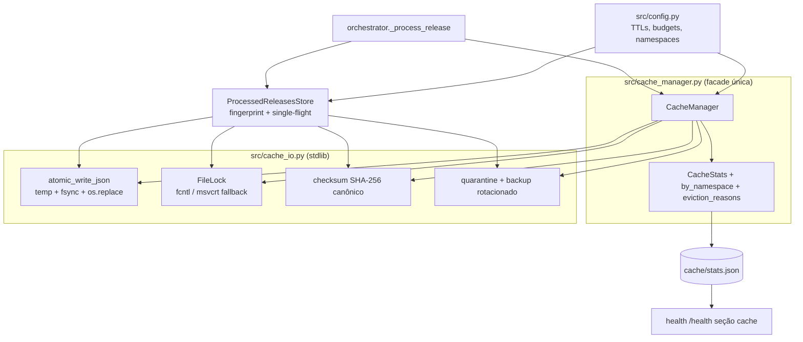

# ADR-011 - Cache Layer Hardening

Camada de cache unificada com escrita atômica, lock de arquivo, integridade verificável (checksum + schema), quarentena com backup rotacionado, fingerprint de releases, budgets LRU, estatísticas persistidas e hashing SHA-256. Resolve a contradição entre a documentação de cache e o `.gitignore`.

## Status

**Aceito** — Implementado em `src/cache_io.py`, `src/cache_manager.py`, `src/processed_releases.py` e consumidores.

## Contexto

O diagnóstico da camada de cache (2026-11-19) encontrou:

| Problema | Evidência |
|----------|-----------|
| Escritas não atômicas (`write_text` direto) em 6 sites | `cache_manager.py`, `main.py`, `salesforce.py`, `release_docs.py`, `llm_adapters/cache.py` |
| Nenhum lock de arquivo em todo o `src/` | grep `fcntl\|msvcrt\|flock` → 0 |
| `cache/processed_releases.json` documentado mas inexistente no código | `docs/maintenance/cache-management.md` vs `src/` |
| MD5 para hashing de conteúdo | `cache_manager.py`, `automation/content.py`, `llm_adapters/cache.py` |
| Corrupção degradava para miss silencioso, sem quarentena/backup; `history.json` propagava `JSONDecodeError` | `release_docs.py` |
| Estatísticas apenas em memória, descartadas por execução | `CacheStats` |
| `clear_expired` com `rglob` (varredura global) por chamada | `cache_manager.py` |
| Doc mandava versionar `cache/`; `.gitignore` ignora `cache/` | contradição operacional |

## Decisão

### 1. `cache/` é runtime e NÃO é versionado (resolve a contradição)

- `cache/` (incluindo `processed_releases.json`, `stats.json`, `quarantine/`, `locks/`) permanece no `.gitignore`.
- O **histórico auditável** vive em:
  1. artefatos de workflow — upload de `cache/` como artefato de execução nos pipelines (`pipeline-cache` artifact, retenção 30 dias);
  2. `releases/` — `.meta.json`, `history.json` regenerado e markdown são a fonte de verdade versionada.
- `docs/maintenance/cache-management.md` passa a instruir esse modelo; a recomendação "Keep cache under version control" fica revogada.
- `.gitignore` ganha `.mutmut-cache/` e `releases/*/.content_cache.json` (caches de runtime não rastreados).

### 2. MD5 → SHA-256 com migração tolerante

- `CacheManager.compute_file_hash`, `automation/content.py` e o embedding placeholder do `SemanticCacheAdapter` passam a usar SHA-256. Nenhum caminho novo usa MD5/SHA-1.
- `load_content_cache` aceita os dois formatos legados (dict de strings e dict de objetos com `content_hash`):
  - hash ausente/vazio ou hex de 32 caracteres (MD5) **com arquivo existente** → recomputa SHA-256 e persiste a migração atomicamente;
  - arquivo inexistente → mantém o hash legado (não invalida tudo); a comparação posterior degrada para "changed" (reprocessamento seguro);
  - valores não-string → ignorados com log.
- `is_content_unchanged` com hash legado de 32 chars retorna `False` (mismatch SHA-256 vs MD5) → um reprocessamento migra a entrada. Sem invalidação em massa.

### 3. Envelope de payload v2 (integridade + recuperação)

Todo arquivo gravado pela camada passa a carregar:

```json
{
  "schema_version": 2,
  "timestamp": 1760000000.0,
  "ttl": 86400,
  "namespace": "llm",
  "last_access": 1760000000.0,
  "checksum": "<sha256 do corpo canônico de data>",
  "data": {}
}
```

- `checksum` = SHA-256 de `json.dumps(data, sort_keys=True, ensure_ascii=False, separators=(",", ":"))`.
- Leitura tolera payload legado v1 (sem `schema_version`/`checksum`): aceito se tiver `data`/`timestamp`/`ttl` válidos; novas gravações saem em v2.
- JSON corrompido, schema incompatível, tipos inválidos ou checksum divergente → **quarentena**: o arquivo é movido para `cache/quarantine/<nome>.<UTC timestamp>.json` com rotação (mantém os 3 mais recentes por nome), o evento é logado (`[CACHE] ...`) e contado em `eviction_reasons["corruption"]`; o fluxo recebe miss/estado vazio e continua. Exceção nunca propaga sem tratamento.
- `ttl < 0` (`CACHE_NEVER_EXPIRE = -1`) = sem expiração (estado incremental). `ttl = 0` mantém a semântica legada de expiração imediata (usada pelos adapters de invalidate — congelada por testes).

### 4. Escrita atômica + lock + single-flight

- `cache_io.atomic_write_json`: serializa e valida **antes** de tocar o disco; arquivo temporário no mesmo diretório (`fsync`) + `os.replace`. Nunca há estado parcial visível.
- `cache_io.FileLock`: `fcntl.flock` exclusivo (Linux/macOS) com fallback `msvcrt.locking` (Windows) e timeout configurável; sem nenhum dos dois, degrada com warning documentado. Locks por entrada (`cache/locks/<hash>.lock`) e por namespace.
- Valores não serializáveis em `set` → `logger.error` + retorno sem escrita (cache não corrompe, exceção não propaga).
- **Single-flight de releases**: `ProcessedReleasesStore.run_once` segura o lock da release durante check → processamento → mark. Duas execuções concorrentes da mesma release produzem exatamente um processamento; a segunda registra hit. Timeout de lock (600s) → a execução concorrente **pula** a release (a outra é dona), com log.

### 5. Estado incremental: `cache/processed_releases.json` (novo)

- Store com envelope v2, sem TTL, invalidação por **fingerprint**.
- Fingerprint determinístico = SHA-256 sobre JSON canônico de: metadados normalizados (`name`, `release_id`, `slug`, `total_features`, categorias ordenadas nome+count — exclui campos voláteis como `generated_at`), hashes SHA-256 dos markdown da release (ordenados por caminho relativo, incluindo `pt_BR/` e `en_US/`) e `PARSER_VERSION` (constante em `config.py`, bump manual quando o parser mudar).
- Fingerprint diferente → miss → reprocessa → mark com novo fingerprint. Conteúdo ou metadados alterados invalidam a entrada.
- Histórico de execuções capped (200 eventos: `processed`, `skipped_hit`, `invalidated`) no próprio arquivo; contadores hits/misses persistidos em `cache/stats.json`.
- Integração: `PipelineOrchestrator._process_release` (dry-run não grava estado).

### 6. Budgets LRU + varredura preguiçosa

- Por namespace: `CACHE_MAX_ENTRIES_PER_NAMESPACE=1000` e `CACHE_MAX_BYTES_PER_NAMESPACE=50MiB` (config). Enforcement no `set`, sob lock do namespace, ordenando por `last_access` (persistido no hit no máximo a cada `CACHE_ACCESS_PERSIST_INTERVAL_SECONDS=60s` — limita write amplification).
- `clear_expired()` varre **apenas namespaces tocados na sessão**; varredura completa só via `clear_expired(full_scan=True)` ou `maintenance()` (manutenção explícita/agendada — `scripts/cache_maintenance.py`).
- `maintenance()` também rotaciona a quarentena. O finalizer de CI limpa somente caches deriváveis (`cache/` runtime); nunca toca `releases/`.

### 7. Observabilidade

- `CacheStats` mantém os campos públicos (`hits`, `misses`, `evictions`, `sets`, `total`, `hit_rate`, `__repr__`) e ganha `by_namespace` (hit rate por namespace) e `eviction_reasons` (`ttl`, `lru`, `corruption`, `manual`).
- `CacheManager.persist_stats()` grava `cache/stats.json` atomicamente ao fim de cada execução (orchestrator); `/health` expõe a seção `cache` lendo esse arquivo (best-effort).
- Logging via `logging.getLogger(__name__)`, padrão `[CACHE] ...`, sem `print`, sem dados sensíveis.

### 8. Configuração centralizada (`src/config.py`)

TTLs atuais preservados como defaults: pipeline 7d, scraper 24h, LLM 7d, ledger 1h, content 30d, impact 24h; trailhead ganha TTL de 7d (antes: sem expiração). Budgets, timeouts de lock, nomes de diretórios e `PARSER_VERSION` vivem em `config.py`.

### 9. Estratégia por instância de cache

| Instância | Tipo | Estratégia alvo | TTL | Invalidação |
|-----------|------|-----------------|-----|-------------|
| `cache/*.json` via `CacheManager` | TTL + namespace | Envelope v2 + lock + escrita atômica + LRU | por config | namespace, expiração, budget |
| `cache/processed_releases.json` | Estado incremental | Fingerprint por release + single-flight | sem expiração (`-1`) | diferença de fingerprint |
| `releases/*/.summary_cache.json` | Artefato versionado | Escrita atômica + validação contra `.meta.json` (existente) | sem expiração | regeneração quando inválido |
| `releases/*/.content_cache.json` | Content-hash | SHA-256 + migração MD5 tolerante | sem expiração | mudança de hash |
| `notifications/trailhead_cache.json` | TTL | Envelope v2 + lock + TTL centralizado (migração do dict legado) | 7d (config) | expiração |
| `releases/history.json` | Histórico | Lock + leitura tolerante + escrita atômica | sem expiração | upsert por slug |
| cache de runner (GitHub Actions) | Dependências e artefatos | `setup-uv enable-cache` com glob `uv.lock`; `actions/cache` (SHA pinado) para `cache/` nos pipelines; upload de `cache/` como artefato | por execução | chave do workflow + `uv.lock` |

### 10. Componentes



## Itens de decisão (exceções e divergências registradas)

1. **`processed_releases.json` não existia** — criado como componente novo (o código real prevaleceu sobre o contexto do prompt; a doc descrevia um arquivo inexistente).
2. **`.summary_cache.json` é versionado** (5 arquivos tracked) — não é movido para quarentena em caso de corrupção; a regeneração atômica in-place é o rebuild, preservando o artefato git. Cópia de backup vai para `cache/quarantine/` quando corrompido.
3. **`invalidate` via `set("", ttl=0)`** nos adapters scraper/LLM permanece — comportamento congelado por `tests/infrastructure/scraping/test_cache_adapter.py:81` e `tests/infrastructure/llm_adapters/test_cache.py:84`. Semântica de `ttl=0` preservada por compatibilidade.
4. **`workflow.py`/`generator.py` não consomem cache** — listados como "prováveis" no prompt; mapeamento real não os incluiu.
5. **mutmut**: `src/cache_manager.py` estava na lista de exclusão do `mutmut_config.toml` (legado, mutmut 2.x) e a ferramenta não está nas dependências. Score antes/depois medido com mutmut 3.8.1 (`uv pip install mutmut`, ferramenta de qualidade já referenciada pelo repo; sem nova dependência de runtime/lock), runner dedicado aos testes do módulo e configuração `[tool.mutmut]` adicionada ao `pyproject.toml` (escopo: camada de cache). O `mutmut_config.toml` legado permanece intacto para o escopo domain/services.
6. **`actions/cache@v6.1.0` (tag mutável) em python-quality.yml** cacheava `tests/__snapshots__` (já versionados — cache inócuo). O step foi **removido**; o cache de dependências dos jobs de quality é feito pelo setup-uv (`enable-cache` + glob `uv.lock`). Nos pipelines (`scheduled-pipeline`, `release_notes_pipeline`), `actions/cache` com SHA pinado restaura `cache/` (chave por `run_id` + prefixo de restore) e o artefato `pipeline-cache` é uploaded a cada execução. O Intelligence Hub não consome a camada de cache de `src/`; recebeu apenas setup-uv pinado com cache por `uv.lock`.
7. **Embedding placeholder do semantic cache** trocado de MD5 para SHA-256: vetores mudam → entradas antigas do index deixam de casar (miss → recomputação). Degradação segura, sem migração de dados (cache derivável).

## Consequences

### Positivas

- Corrupção nunca derruba o pipeline: quarentena + rebuild + log auditável.
- Concorrência CI/multiprocesso segura: atomicidade + flock + single-flight (exatamente um processamento por release).
- Reprocessamento incremental real: fingerprint detecta conteúdo/metadados/parser alterados.
- Observabilidade por execução: hit rate por namespace, motivos de eviction, `/health` e artefatos de CI.
- Custo de I/O controlado: varredura preguiçosa, budgets LRU, `last_access` persistido com throttle.

### Negativas / Trade-offs

- Write amplification no hit (rewrite do envelope no máx. 1×/60s por entrada) — mitigado pelo throttle configurável.
- Lock files acumulam em `cache/locks/` (não removidos para evitar corrida com waiters) — ínfimos; limpeza via manutenção.
- `last_access` entre processos é aproximado (throttle) — LRU cross-process degrada gracefully para ordem de escrita.
- Fingerprint inclui hash dos markdown: leitura de ~25 arquivos por release por checagem — aceitável para pipeline semanal.
- `PARSER_VERSION` exige bump manual em mudanças de parser (documentado em `config.py`).

## Testes

```bash
uv run --no-sync pytest tests/test_cache_io.py tests/test_cache_manager.py tests/test_processed_releases.py -v
uv run --no-sync pytest tests/ --cov=src --cov-fail-under=95
```

Cobertura mínima de 95% no módulo de cache; cenários determinísticos com relógio injetado (sem `time.sleep` em testes): corrupção, checksum inválido, TTL, permissão negada, não serializáveis, chaves unicode, lock multiprocesso, migração legada, determinismo de estatísticas.

## Referências

- `src/cache_io.py` — primitivas (atomic write, lock, checksum, quarentena)
- `src/cache_manager.py` — facade `CacheManager` / `CacheStats`
- `src/processed_releases.py` — estado incremental + fingerprint + single-flight
- `src/config.py` — seção "Cache Layer (ADR-011)"
- `docs/maintenance/cache-management.md` — operação e recuperação
- ADR-010 (LLM Cache Strategy) — estratégia dual-cache LLM, preservada
- ADR-005 (Documentation Reconciliation) — docs reconciliadas após esta mudança