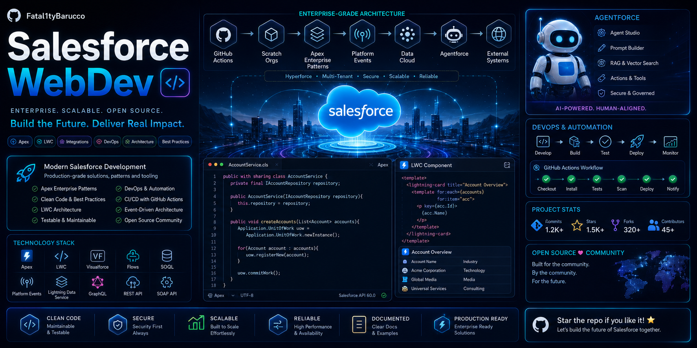
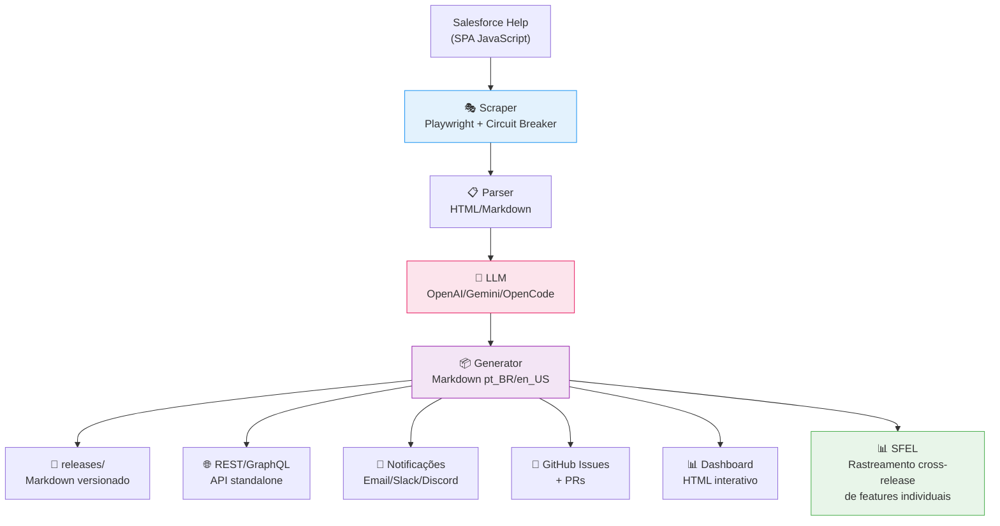
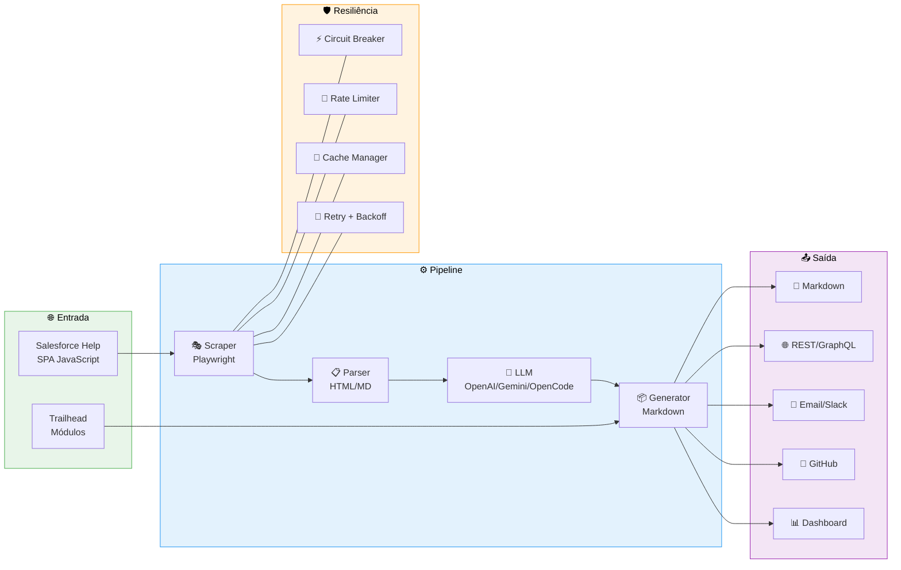
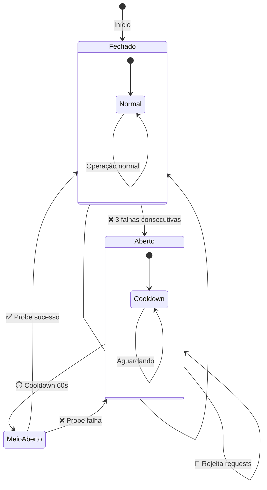
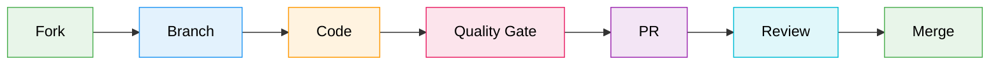

# Salesforce Release Intelligence

<figure class="hero-banner-wrapper">
  
  <figcaption class="hero-caption">Pipeline Knowledge-as-Code para extração, enriquecimento via IA e versionamento das Release Notes da Salesforce</figcaption>
</figure>

Pipeline automatizado para extração, classificação, análise e versionamento das **Release Notes da Salesforce** como artefatos Markdown estruturados, com enriquecimento via LLM, classificação de impacto e distribuição multi-canal.

## 📋 Releases Disponíveis

| Release | Features | Categorias | Status |
| :--- | :---: | :---: | :---: |
| ❄️ **Winter '27** | 1,123 | 19 | ✅ Atual |
| ☀️ **Summer '26** | 1,373 | 22 | ✅ Completo |
| 🌸 **Spring '26** | 1,438 | 21 | ✅ Completo |
| ❄️ **Winter '26** | 1,348 | 19 | ✅ Completo |

> Cada release inclui **resumos executivos gerados por IA** (até 5.000 caracteres), **resumos por categoria** (até 1.000 caracteres), e **documentação completa em português e inglês**.

**📄 Documentação completa:**

- [🇧🇷 Português](index.md)
- [🇺🇸 English](https://github.com/Fatal1tyBarucco/Salesforce-WebDev/blob/main/README.en.md#-releases-disponíveis)

---

## O Que Este Repositório Faz

O **Salesforce-WebDev** é um pipeline inteligente automatizado (**Knowledge-as-Code**) que extrai, enriquece via LLM e versiona as Release Notes da Salesforce em Markdown (pt_BR e en_US).



O pipeline inclui uma camada de automação AI com **12 módulos**, sendo um deles o **Salesforce Feature Evolution Ledger (SFEL)** — submódulo `src/automation/ledger/` que rastreia features individuais entre releases consecutivas e mantém histórico consultável.

### Camadas do Pipeline

| Camada | Módulos | Responsabilidade |
|--------|---------|------------------|
| **Orquestração** | `main.py`, `orchestrator.py` | Pipeline principal, DI, detecção de novas releases |
| **Scraping** | `scraper.py` | Playwright headless, circuit breaker, rate limiter |
| **Parsing** | `parser.py` | Árvore de navegação, tabelas de feature impact |
| **LLM** | `llm_service.py` | Multi-provider (OpenAI/Gemini/OpenCode), retry, fallback, rate limiting |
| **Enriquecimento AI** | `feature_enricher.py`, `release_summarizer.py` | Descrições por feature, resumos executivos, impacto por categoria |
| **Automação AI** | `automation/` (12 módulos) | Relatórios AI, triage, impacto, deduplicação, exportação, SFEL |
| **Integração** | `salesforce.py`, `workflow.py` | Trailhead, GitHub CLI, PRs |
| **Saída** | `generator.py`, `release_docs.py`, `notifications.py`, `dashboard.py` | Markdown enriquecido, Email, Slack, Discord, Dashboard |
| **API** | `api.py` | REST + GraphQL + Autenticação + OpenAPI |
| **Infra** | `cache_manager.py`, `circuit_breaker.py`, `events.py`, `health.py` | Cache, resiliência, event bus, Prometheus metrics |

### Automação AI — 12 Módulos

| Módulo | Função |
|--------|--------|
| `automation/service.py` | `AIAutomationService` — Facade para todas as operações AI |
| `automation/reporting.py` | Changelog, regression, diff, quality reports |
| `automation/comparison.py` | Comparação entre releases, detecção de regressões |
| `automation/impact.py` | Análise de impacto por categoria, predição |
| `automation/content.py` | Deduplicação por content-hash |
| `automation/export.py` | Exportação JSON/CSV |
| `automation/github_ops.py` | Criação de GitHub Issues |
| `automation/notifications.py` | Notificações filtradas por perfil |
| `automation/models.py` | Dataclasses (11 modelos) |
| `automation/badge.py` | Badges dinâmicos |
| `automation/ledger/` | **SFEL** — Rastreamento cross-release de features individuais com 5 níveis de matching (EXACT, CATEGORY_CHANGE, FUZZY, HEURISTIC, LLM), geração de `LedgerDiff`/`LedgerStats`, histórico consultável por feature nome, cache TTL + content-hash, eventos no EventBus. Ver [ADR-006](architecture/decisions/adr-006-feature-evolution-ledger.md) |

### Salesforce Feature Evolution Ledger (SFEL)

Rastreia features individuais entre releases consecutivas e mantém histórico consultável. O `FeatureLinker` compara features usando 5 níveis de matching em ordem de confiança (first-match-wins):

1. **EXACT** — nome normalizado idêntico + mesma categoria → `ALIVE` ou `CATEGORY_CHANGED`
2. **FUZZY** — Jaccard dos tokens do nome ≥ 0.5 + mesma categoria → `RENAMED` ou `ALIVE`
3. **HEURISTIC** — mesma categoria + melhor par mútuo com Jaccard ≥ 0.2 → `RENAMED`
4. **LLM** — similaridade 0.2–0.5, desambiguação opcional via LLM → `RENAMED` ou `ALIVE`

`FeatureEvolutionLedgerService` gera `LedgerDiff` + `LedgerStats` entre dois releases, cacheia com TTL 1h via `CacheManager` (namespace `sfel`), emite evento `ledger.generated` no EventBus e permite consulta de histórico completo de qualquer feature.

**Status de lifecycle:** `BORN`, `ALIVE`, `RENAMED`, `CATEGORY_CHANGED`, `DEPRECATED`, `REMOVED`.

---

## 🏗️ Arquitetura em Camadas



---

## ⚡ Quick Start

### Pré-requisitos

| Requisito | Versão | Instalação |
|:----------|:-------|:-----------|
| Python | 3.14+ | [python.org](https://www.python.org/) |
| uv | Latest | `curl -LsSf https://astral.sh/uv/install.sh \| sh` |
| Playwright | Chromium | `uv run playwright install chromium` |

### Instalação

```bash
# 1. Clone o repositório
git clone https://github.com/Fatal1tyBarucco/Salesforce-WebDev.git
cd Salesforce-WebDev

# 2. Instale dependências
uv sync --extra dev

# 3. Instale o navegador Playwright
uv run playwright install chromium

# 4. Instale os hooks de pré-commit (ruff, black, mypy, pytest)
uv run pre-commit install
uv run pre-commit install --hook-type pre-push

# 5. Configure as chaves LLM (pelo menos uma)
export OPENAI_API_KEY="sk-..."    # ou
export GOOGLE_API_KEY="AIza..."   # ou
export OPENCODE_API_KEY="..."
```

### Execução

```bash
# Pipeline completo
uv run python src/main.py

# Release específica
uv run python src/main.py --release summer_26

# Dry run (sem escrever arquivos)
uv run python src/main.py --dry-run

# Iniciar API server
uv run python -c "from src.api import start_api_server; start_api_server()"

# Iniciar health server
uv run python -c "from src.health import start_health_server; start_health_server()"
```

---

## 🛡️ Resiliência

O pipeline foi projetado para operar de forma autônoma e resiliente:



| Componente | Configuração | Comportamento |
|:-----------|:-------------|:--------------|
| ⚡ **Circuit Breaker** | 3 falhas → 60s cooldown | Para após falhas consecutivas, retoma automaticamente |
| 🚦 **Rate Limiter** | Token-bucket, 2 req/s | Respeita limites do Salesforce |
| 🔄 **Retry** | 5 tentativas, backoff exponencial | `2^n` segundos + jitter aleatório |
| 💾 **Cache TTL** | 24h (metadata), 30d (content-hash) | Evita refetch de conteúdo inalterado |
| ⏱️ **Timeout** | 30s (HTTP), 60s (LLM) | Nunca fica preso indefinidamente |

---

## 🧪 Qualidade de Código

```bash
# Quality gate completa (mesma do CI)
uv run ruff check src/          # Linter
uv run black --check src/       # Formatter
uv run mypy src/                # Type checker (strict)
uv run pytest tests/ --cov=src --cov-fail-under=95  # Tests + coverage
```

| Ferramenta | Configuração | Status |
|:-----------|:-------------|:------:|
| 🐍 **Python** | 3.14, type hints completos | ✅ |
| 🔍 **Mypy** | `strict = true` | ✅ |
| ⚡ **Ruff** | `line-length = 100` | ✅ |
| 🖤 **Black** | `target-version = py314` | ✅ |
| 🧪 **Pytest** | 95%+ cobertura | ✅ |
| 📦 **uv** | Lock file determinístico | ✅ |

---

## 🤖 Automação AI

O pipeline utiliza LLM (OpenAI, Google Gemini, OpenCode) para gerar conteúdo inteligente:

### Enriquecimento de Features (`feature_enricher.py`)

Cada feature das release notes recebe automaticamente:

- **Descrição profissional** com contexto de negócio
- **Classificação de impacto**: 🔴 Alto / 🟡 Médio / 🟢 Baixo
- **Audiência identificada**: Usuários / Admins / Ambos

```markdown
| Recurso | Descrição | Impacto |
| :--- | :--- | :---: |
| **Voice Feature** | Permite interação por voz com Agentforce, reduzindo ~40% do tempo em tarefas repetitivas. | 🔴 alto |
```

### Resumos Executivos (`release_summarizer.py`)

Cada release recebe um resumo completo com:

- **Visão Geral**: 3-5 frases com escopo e foco principal
- **Impacto para o Negócio**: valor concreto com exemplos reais
- **Temas Estratégicos**: AI-First, Security, Developer Experience, etc.
- **Top 5 Categorias**: com destaque e percentual
- **Notas de Migração**: considerações para administradores

### Introduções por Categoria

Cada arquivo de categoria inclui:

- Parágrafo introdutório AI sobre o tema e mudanças mais importantes
- Linha de impacto: `🔴 5 alto | 🟡 12 médio | 🟢 3 baixo`

### Cadeia de Fallback

```text
OpenAI → Google Gemini → OpenCode → Classificação Heurística
```

Quando nenhum LLM está disponível, o sistema usa classificação por keywords como fallback.

---

## 📊 Salesforce Feature Evolution Ledger (SFEL)

Submódulo `src/automation/ledger/` que rastreia features individuais entre releases consecutivas e mantém histórico consultável de cada feature.

### Problema que resolve

O pipeline processa cada release isoladamente. Sem uma camada de rastreamento cross-release, não é possível saber se uma feature presente no summer_26 é a mesma que estava no spring_26, se mudou de nome, se mudou de categoria, ou se foi removida.

Módulos relacionados (não substituidos):

- `automation/comparison.py` — compara releases a nível de **categoria**, não de feature individual
- `automation/impact.py` — analisa impacto de uma release isolada
- `nl_search.py` — busca estática em um release

### Como funciona

O `FeatureLinker` compara features de duas releases consecutivas usando 5 níveis de matching em ordem de confiança (first-match-wins):

1. **EXACT** — nome normalizado idêntico + mesma categoria → `ALIVE` ou `CATEGORY_CHANGED`
2. **FUZZY** — Jaccard dos tokens do nome ≥ 0.5 + mesma categoria → `RENAMED` ou `ALIVE`
3. **HEURISTIC** — mesma categoria + melhor par mútuo com Jaccard ≥ 0.2 → `RENAMED`
4. **LLM** — similaridade 0.2–0.5, desambiguação opcional via LLM → `RENAMED` ou `ALIVE`

O `FeatureEvolutionLedgerService` orquestra:

- Extração de features de .md files (nome normalizado, categoria, snippet)
- Geração de `LedgerDiff` (features born/alive/renamed/category_changed/deprecated/removed entre dois releases) + `LedgerStats` (contagens agregadas)
- Cache com TTL 1h usando o `CacheManager` existente (namespace `sfel`)
- Consulta de histórico de uma feature (`get_feature_history("Flow Builder")` → timeline completa)
- Emissão de evento `ledger.generated` no EventBus

### Status das lifecycle

| Status | Significado |
|:--------|:------------|
| `BORN` | Presente apenas na release atual |
| `ALIVE` | Presente em ambas as releases, inalterada |
| `RENAMED` | Mesma feature, nome diferente (detected por fuzzy/heuristic/llm) |
| `CATEGORY_CHANGED` | Mesmo nome, categoria diferente |
| `DEPRECATED` | Marcada como depreciada na release atual |
| `REMOVED` | Presente apenas na release anterior |

### Exemplo de uso

```python
from src.automation.ledger.service import FeatureEvolutionLedgerService

svc = FeatureEvolutionLedgerService()
# Diff entre duas releases consecutivas
diff = await svc.generate_ledger("summer_26", "spring_26")
print(f"{diff.born_count} features novas, {diff.removed_count} removidas")

# Histórico completo de uma feature
history = await svc.get_feature_history("Flow Builder")
print(f"Viu {history.total_releases_seen} releases, status atual: {history.current_status}")
```

### Testes

```text
tests/test_ledger/  — 70+ testes (linker, service, modelos, prompts, branches/erro handling)
```

Cobertura com `pytest --cov=src.automation.ledger --cov-fail-under=95`.

> **Nota:** o módulo é autonomous — não é chamado pelo pipeline principal. Integração via `orchestrator.py` é trabalho futuro (ver ADR-006).

---

## 🌐 API

O projeto expõe uma API REST + GraphQL standalone (zero dependências externas):

### Autenticação

Quando a variável de ambiente `API_KEY` está definida, todos os endpoints (exceto `/health`, `/ready`, `/metrics`, `/openapi.json`) requerem autenticação:

```bash
# Via header X-API-Key
curl -H "X-API-Key: ***" http://localhost:8081/releases

# Via Authorization Bearer
curl -H "Authorization: Bearer ***" http://localhost:8081/releases
```

### REST

```bash
# Listar todas as releases
curl http://localhost:8081/releases

# Detalhes de uma release
curl http://localhost:8081/releases/summer_26

# Features de uma categoria
curl http://localhost:8081/releases/summer_26/categories/agentforce

# Comparar duas releases
curl http://localhost:8081/diff/summer_26/spring_26
```

### GraphQL

```bash
# Query flexível
curl -X POST http://localhost:8081/graphql \
  -H "Content-Type: application/json" \
  -d '{"query": "{ releases { name totalFeatures categories { name count } } }"}'
```

### Health & Metrics

```bash
# Health check
curl http://localhost:8080/health

# Readiness probe
curl http://localhost:8080/ready

# Prometheus metrics (prometheus-client quando instalado)
curl http://localhost:8080/metrics
```

---

## 📁 Estrutura do Projeto

```text

Salesforce-WebDev/
  ├── ai/
      ├── collectors/
      ├── config/
      ├── generators/
      ├── integrations/
      ├── llm/
      ├── prompts/
      ├── schemas/
      └── orchestrator.py
  ├── automation/
      ├── ledger/
      ├── badge.py
      ├── comparison.py
      ├── content.py
      ├── export.py
      ├── github_ops.py
      ├── impact.py
      ├── models.py
      ├── notifications.py
      ├── reporting.py
      └── service.py
  ├── core/
      ├── classification/
      ├── enrichment/
      ├── pipeline/
      ├── summarization/
  ├── design-system/
      ├── components/
  ├── domain/
      ├── llm.py
      └── scraper.py
  ├── impact_propagation/
      ├── engine.py
      ├── graph_builder.py
      ├── heuristic_fallback.py
      └── models.py
  ├── infrastructure/
      ├── api/
      ├── llm_adapters/
      ├── mcp/
      ├── scraping/
      ├── generation.py
      ├── github.py
      ├── llm.py
      ├── messaging.py
      ├── notification_step.py
      ├── parsing.py
      ├── storage.py
      └── translation.py
  ├── limiters/
      └── rate_limiter.py
  ├── models/
      ├── api.py
      ├── classification.py
      ├── enrichment.py
      ├── feature.py
      └── release.py
  ├── ai_automation.py
  ├── analytics.py
  ├── api.py
  ├── cache_io.py
  ├── cache_manager.py
  ├── circuit_breaker.py
  ├── config.py
  ├── dashboard.py
  ├── documentation_service.py
  ├── events.py
  ├── exceptions.py
  ├── feature_classifier.py
  ├── feature_enricher.py
  ├── generator.py
  ├── health.py
  ├── heuristic_classifier.py
  ├── i18n.py
  ├── impact_analyzer.py
  ├── issue_triage.py
  ├── llm_service.py
  ├── logger.py
  ├── main.py
  ├── nl_search.py
  ├── notifications.py
  ├── orchestrator.py
  ├── parser.py
  ├── processed_releases.py
  ├── release_discovery.py
  ├── release_docs.py
  ├── release_summarizer.py
  ├── salesforce.py
  ├── scraper.py
  ├── smart_notifications.py
  ├── translator.py
  └── workflow.py
  ├── .claude/
  ├── .devcontainer/
  ├── .github/                   # Workflows e scripts do GitHub
  ├── docs/                      # Documentação MkDocs
  ├── intelligence/
  ├── k8s/                       # Manifestos Kubernetes
  ├── prompts/
  ├── releases/                  # Artefatos Markdown por release
  ├── report_parts/
  ├── scripts/                   # Scripts utilitários
  ├── tests/                     # Suíte pytest
  ├── .mcp.json
  ├── .promptfoo.yaml
  ├── .python-version
  ├── .ruffignore
  ├── AGENTS.md                  # Diretrizes para agentes de código
  ├── CHANGELOG.md               # Changelog do projeto
  ├── CLAUDE.md
  ├── CONTRIBUTING.md            # Guia de contribuição
  ├── DESIGN.md
  ├── Dockerfile                 # Imagem Docker de runtime
  ├── FASE5_COMPLETION_REPORT.md
  ├── IA_AUDIT_REPORT.md
  ├── MUTATION_TESTING_REPORT.md
  ├── PLANO_DE_MODERNIZACAO.md
  ├── PRODUCT.md
  ├── PROPOSTA_FEATURE_RIPE.md
  ├── README.en.md               # Readme em inglês
  ├── README.md                  # Readme em português
  ├── SECURITY.md                # Política de segurança
  ├── commit_fixes.sh
  ├── drift_report.json
  ├── fix_md.py
  ├── mkdocs.yml                 # Configuração MkDocs
  ├── mutmut_config.toml
  ├── pr_body.md
  ├── pyproject.toml             # Configuração do projeto
  ├── reconcile_summary.md
  ├── update
  └── uv.lock                    # Lockfile determinístico
```

---

## 🤝 Contribuição



1. **Fork** o repositório
2. Crie uma branch: `git checkout -b feature/minha-feature`
3. Instale dependências: `uv sync --extra dev`
4. Execute a quality gate completa:

   ```bash
   uv run ruff check src/ && uv run black --check src/ && uv run mypy src/ && uv run pytest --cov=src --cov-fail-under=95
   ```

5. Commit: `git commit -m 'feat: descrição da alteração'`
6. Push: `git push origin feature/minha-feature`
7. Abra um **Pull Request**

---

## 📄 Licença

Este projeto é mantido para fins educacionais e de referência técnica.

---

<figure class="footer-banner">
  
</figure>

<div align="center">

## Feito com ☕ e código Python

[⬆ Voltar ao topo](#salesforce-release-intelligence)

</div>

<!--
Salesforce Release Intelligence — Pipeline automatizado de Release Notes da Salesforce com IA
Knowledge-as-Code | Feature Evolution Ledger (SFEL) | Multi-provider LLM | Playwright Scraping
Tags: salesforce, release-notes, ai-pipeline, knowledge-as-code, playwright, llm, automation, devops
-->
