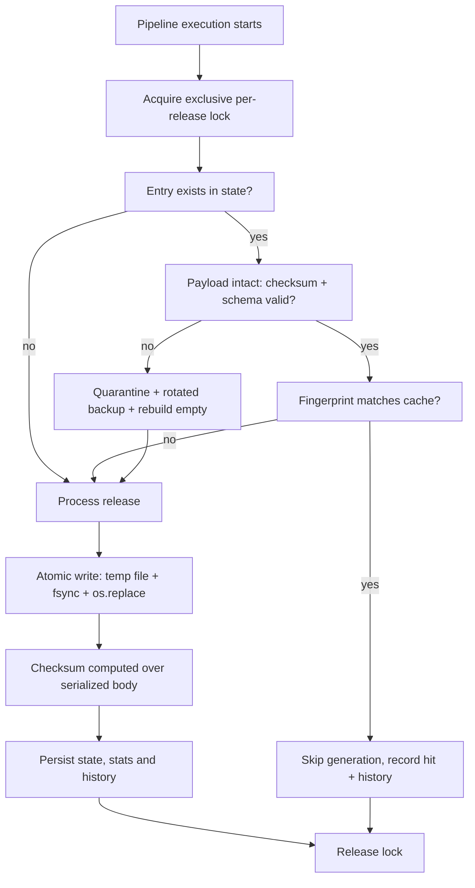

# Cache Management

## Objective

Prevent duplicated release processing and maintain pipeline execution consistency, with safe concurrency, failure recovery and per-run observability (ADR-011).

## Cache Location

```text
cache/processed_releases.json   # incremental state: fingerprints + execution history
cache/stats.json                # per-run statistics (hits, misses, evictions by reason)
cache/<sha256(key)>.json        # TTL entries (scraper, pipeline, ledger, LLM, impact)
cache/<namespace>/<hash>.json   # namespaced TTL entries
cache/quarantine/               # rotated backups of corrupt payloads (kept: 3 per file)
cache/locks/                    # lock files (entry, namespace and per-release)
```

All TTLs, budgets and directory names are centralized in `src/config.py` (section "Cache Layer (ADR-011)").

## Versioning Policy (ADR-011)

`cache/` is **runtime data and is NOT versioned** (`.gitignore`). The auditable history lives in:

1. **Workflow artifacts** — the pipelines upload `cache/` as the `pipeline-cache` artifact (30-day retention) on every run.
2. **`releases/`** — `.meta.json`, markdown and the regenerated `history.json` are the versioned source of truth.

> The previous recommendation "Keep cache under version control" is **revoked**: it contradicted `.gitignore` and would commit machine-local, derivable state.

## Responsibilities

The cache layer is responsible for:

- tracking processed releases by deterministic fingerprint
- avoiding duplicated markdown generation (single-flight across concurrent runs)
- maintaining release execution history (capped at 200 events)
- enabling incremental processing between CI runs (runtime cache restored via `actions/cache`)
- supporting failure recovery (quarantine + rebuild, never an unhandled exception)

## Read/Write Flow



TTL entries (`CacheManager.get`) additionally evict expired payloads on read (reason `ttl`); namespaces enforce LRU budgets (1000 entries / 50 MiB by default, reason `lru`).

## Release Fingerprinting

`compute_release_fingerprint` (in `src/processed_releases.py`) hashes, with SHA-256 over canonical JSON:

- normalized `.meta.json` fields: `name`, `release_id`, `slug`, `total_features`, categories sorted by name+count (volatile fields such as `generated_at` are excluded);
- the SHA-256 of every markdown file in the release directory (sorted by relative path, including `pt_BR/` and `en_US/`);
- `PARSER_VERSION` from `src/config.py` — **bump this constant when parser changes alter generated content** to force reprocessing.

A fingerprint difference invalidates the entry and triggers reprocessing; a match records a hit and skips generation.

## Cache Lifecycle

### Initialization

The state file is created automatically on the first successful processing. Missing state degrades to an empty store (everything is processed once).

### Update

After successful processing, the release fingerprint is persisted atomically under the state lock. Failed processing is never marked.

### Validation

Before processing, the orchestrator compares the current fingerprint with the stored one while holding the per-release lock (single-flight): two concurrent executions of the same release produce exactly one processing.

## Recovery Procedure

Recovery is **automatic** — no manual steps are required:

1. Corrupt JSON, incompatible schema or checksum mismatch → the file is moved to `cache/quarantine/<name>.<UTC timestamp>.json` (the 3 most recent copies per file are kept).
2. The store rebuilds from empty state and the pipeline continues (miss, not crash).
3. The next successful run repopulates the cache.
4. Generated markdown and README regeneration can be validated as usual after a recovery run.

Manual inspection (optional): quarantined copies are plain JSON snapshots of the corrupt payload, useful for diagnosing disk/FS issues.

## Operational Recommendations

- Never manually edit cache files during pipeline execution; all writes go through the cache layer (atomic + locked).
- Do **not** commit `cache/` — retrieve the `pipeline-cache` workflow artifact for auditing.
- After workflow failures, inspect `cache/stats.json` (eviction reasons: `ttl`, `lru`, `corruption`, `manual`) and the quarantine directory.
- After parser updates, bump `PARSER_VERSION` in `src/config.py` to invalidate fingerprints.
- Run explicit maintenance (full expired sweep + quarantine report) with:

```bash
uv run python scripts/cache_maintenance.py --cache-dir cache
```

The CI finalizer runs this automatically; it cleans only safely derivable runtime caches and never touches `releases/`.

## Observability

- `CacheStats` persists per run to `cache/stats.json`: aggregate counters, hit rate per namespace and eviction counts by reason.
- The `/health` endpoint exposes the last persisted stats under the `cache` key.
- Logs follow the `[CACHE] ...` structured pattern via `logging` (no `print`).

## Implemented Improvements (ADR-011)

The former "Future Improvements" list is now implemented:

- ✅ release metadata hashing (normalized meta in the fingerprint)
- ✅ cache expiration strategy (centralized TTLs, lazy eviction, LRU budgets)
- ✅ release fingerprinting (content + meta + parser version)
- ✅ semantic diff validation — covered by content-hash change detection (`analyze_content_changes`) and fingerprint invalidation
- ⏳ distributed cache support — intentionally out of scope (filesystem is sufficient; see ADR-011)